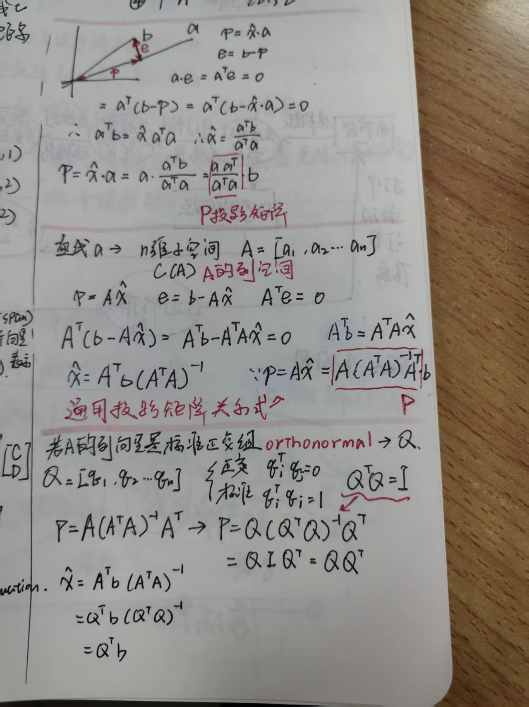
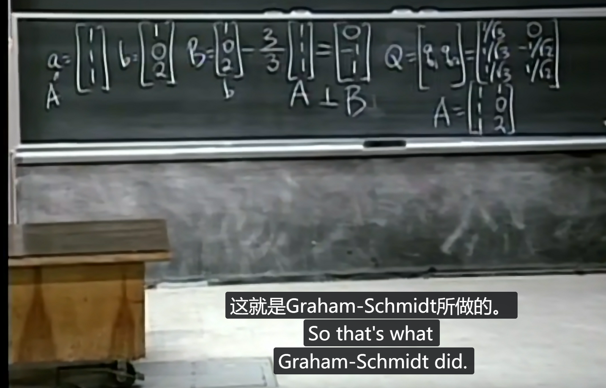

# Projections onto subspaces

## 本章主线与范围

前面已经知道，$`A\mathbf{x}`$ 是矩阵各列的线性组合，因此它只能落在 $`A`$ 的列空间中。本章把这个观点用于投影问题：当目标向量不在列空间中时，寻找列空间中距离它最近的向量。

本章分成四个阶段。前三个阶段建立投影与最小二乘，最后一个阶段从标准正交列继续走到 Gram–Schmidt 与 QR 分解：

```text
纯向量投影：把 b 投影到 span(a)
    -> 残差垂直于 span(a)
    -> 用点积写出正交条件
    -> 得到投影系数与投影矩阵
推广到子空间 Col(A)
    -> p=A x_hat
最小二乘应用
    -> 把多个纵向残差组成一个残差向量
    -> 整体残差向量垂直于 Col(A)
    -> A^T(b-A x_hat)=0
    -> A^T A x_hat=A^T b
标准正交列
    -> Q^T Q=I
    -> P=Q Q^T
    -> Gram-Schmidt 保持列空间不变并把 A 变成 Q
    -> 原列在 Q 下的坐标组成上三角矩阵 R
    -> A=QR
```

这里的核心不是记住某一个孤立公式，而是理解：**最近点的误差必须垂直于投影所在的子空间。**

### 阅读前先分清三种对象

本章中会先后出现“直线”和“误差”，但它们并不总是指同一个几何对象：

| 对象 | 所在空间 | 含义 |
| --- | --- | --- |
| $`\mathrm{span}\{a\}`$ | 向量 $`a`$ 所在的 $`\mathbb{R}^m`$ | 纯向量投影的目标子空间 |
| $`y=C+Dt`$ | 二维 $`(t,y)`$ 散点图 | 回归模型画出来的拟合直线 |
| $`\mathrm{Col}(A)`$ | 观测值空间 $`\mathbb{R}^m`$ | 所有模型预测向量组成的子空间 |

> **投影问题中的目标直线 $`\mathrm{span}\{a\}`$，不是散点图里的拟合直线 $`y=C+Dt`$。回归中的正交条件发生在观测值空间：整体残差向量垂直于 $`\mathrm{Col}(A)`$。**

## 一、纯向量投影：投影到 $`\mathrm{span}\{a\}`$

### 1. 几何对象

这一节先完全不讨论线性回归。给定向量 $`b`$，把它投影到向量 $`a`$ 所在的直线。这里的直线是

```math
\mathrm{span}\{\mathbf{a}\}
=
\{x\mathbf{a}:x\in\mathbb{R}\}.
```

其中：

| 符号 | 含义 |
| --- | --- |
| $`a`$ | 决定投影方向的向量 |
| $`b`$ | 被投影的原向量 |
| $`p`$ | $`b`$ 在 $`\mathrm{span}\{a\}`$ 上的投影点 |
| $`e=b-p`$ | 投影误差 |

几何上，投影点 $`p`$ 是 $`\mathrm{span}\{a\}`$ 中距离 $`b`$ 最近的点。因此误差 $`e`$ 必须垂直于 $`\mathrm{span}\{a\}`$，也就是垂直于 $`a`$：

```math
\mathbf{e}=\mathbf{b}-\mathbf{p},
\qquad
\mathbf{e}\perp\mathbf{a}.
```

这条“误差垂直于投影空间”的事实是后面所有公式的起点。

### 2. 为什么投影点写成 $`p=x a`$

因为 $`p`$ 位于 $`a`$ 张成的直线上，所以它一定是 $`a`$ 的某个倍数：

```math
\mathbf{p}=x\mathbf{a}.
```

这里的 $`x`$ 是标量，表示投影向量是 $`a`$ 的多少倍。它不是投影向量本身，也不是向量。

于是误差为

```math
\mathbf{e}
=
\mathbf{b}-\mathbf{p}
=
\mathbf{b}-x\mathbf{a}.
```

### 3. 用点积写出正交条件

两个向量正交，当且仅当它们的点积为零：

```math
\mathbf{a}\cdot\mathbf{e}=0.
```

在线性代数的矩阵语言中，点积写成转置乘法：

```math
\mathbf{a}\cdot\mathbf{e}
=
\mathbf{a}^{T}\mathbf{e}.
```

例如，若 $`a`$ 和 $`e`$ 都是 $`3\times1`$ 的列向量，则

```math
\mathbf{a}^{T}\mathbf{e}
=
\begin{bmatrix}a_1&a_2&a_3\end{bmatrix}
\begin{bmatrix}e_1\\e_2\\e_3\end{bmatrix}
=
a_1e_1+a_2e_2+a_3e_3.
```

因此，正交条件也可以写成

```math
\mathbf{a}^{T}\mathbf{e}=0.
```

把 $`e=b-xa`$ 代入，得到投影的基本方程：

```math
\boxed{\mathbf{a}^{T}(\mathbf{b}-x\mathbf{a})=0}.
```

### 4. 求投影系数

从

```math
\mathbf{a}^{T}(\mathbf{b}-x\mathbf{a})=0
```

展开：

```math
\mathbf{a}^{T}\mathbf{b}
-x\mathbf{a}^{T}\mathbf{a}
=0.
```

移项并除以 $`a^T a`$，得到

```math
\boxed{
x=\frac{\mathbf{a}^{T}\mathbf{b}}{\mathbf{a}^{T}\mathbf{a}}
}.
```

这里要求 $`a\neq0`$，这样 $`a^T a=\|a\|^2`$ 才不为零。

### 5. 与几何中的投影长度对应

点积满足

```math
\mathbf{a}^{T}\mathbf{b}
=
\mathbf{a}\cdot\mathbf{b}
=
\|\mathbf{a}\|\,\|\mathbf{b}\|\cos\theta,
```

并且

```math
\mathbf{a}^{T}\mathbf{a}=\|\mathbf{a}\|^2.
```

所以系数 $`x`$ 也可以写成

```math
x
=
\frac{\|\mathbf{b}\|\cos\theta}{\|\mathbf{a}\|}.
```

要注意，$`\|b\|\cos\theta`$ 是 $`b`$ 在 $`a`$ 方向上的有符号投影长度，而 $`x`$ 是“投影向量是 $`a`$ 的多少倍”。两者不是同一个量。

投影向量还需要乘上 $`a`$ 方向的单位向量，因此几何写法是

```math
\mathbf{p}
=
\|\mathbf{b}\|\cos\theta
\frac{\mathbf{a}}{\|\mathbf{a}\|}.
```

用点积改写后：

```math
\boxed{
\mathbf{p}
=
\mathbf{a}\frac{\mathbf{a}^{T}\mathbf{b}}{\mathbf{a}^{T}\mathbf{a}}
}.
```

所以，几何中的长度角度公式和线性代数中的转置公式描述的是同一个投影。

## 二、投影矩阵

### 1. 从投影向量得到矩阵

投影向量可以写成

```math
\mathbf{p}
=
\mathbf{a}\frac{\mathbf{a}^{T}\mathbf{b}}{\mathbf{a}^{T}\mathbf{a}}.
```

因为 $`a^T b`$ 是标量，可以调整乘法顺序：

```math
\mathbf{p}
=
\frac{\mathbf{a}\mathbf{a}^{T}}{\mathbf{a}^{T}\mathbf{a}}\mathbf{b}.
```

定义

```math
\boxed{
P=\frac{\mathbf{a}\mathbf{a}^{T}}{\mathbf{a}^{T}\mathbf{a}}
}.
```

于是

```math
\boxed{\mathbf{p}=P\mathbf{b}}.
```

矩阵 $`P`$ 的作用是：输入任意向量 $`b`$，输出它在 $`a`$ 所张成直线上的投影。

### 2. 区分 $`a^T a`$ 与 $`a a^T`$

若 $`a`$ 是 $`m\times1`$ 列向量，则 $`a^T`$ 是 $`1\times m`$ 行向量。因此

```math
\mathbf{a}^{T}\mathbf{a}
:
(1\times m)(m\times1)=1\times1,
```

它是一个标量，并且等于 $`\|a\|^2`$。

而

```math
\mathbf{a}\mathbf{a}^{T}
:
(m\times1)(1\times m)=m\times m,
```

它是一个矩阵。

因此乘法顺序不能交换：

```math
\mathbf{a}^{T}\mathbf{a}
\neq
\mathbf{a}\mathbf{a}^{T}.
```

### 3. 投影矩阵的性质

投影到一条直线时，投影矩阵满足：

```math
P^{T}=P.
```

因此 $`P`$ 是对称矩阵。

它还满足

```math
P^{2}=P.
```

原因是第一次投影后，向量已经在目标直线上，再投影一次不会发生变化。

此外，$`P`$ 的所有输出都位于 $`\mathrm{span}\{a\}`$，所以

```math
\mathrm{Col}(P)=\mathrm{span}\{\mathbf{a}\},
\qquad
\mathrm{rank}(P)=1.
```

这里的秩为 1，是因为投影矩阵的输出只有一个独立方向。

## 三、从直线推广到子空间

### 1. 子空间由多个方向张成

现在不再只投影到一条直线，而是投影到由两个向量 $`a_1,a_2`$ 张成的平面：

```math
\mathrm{span}\{\mathbf{a}_1,\mathbf{a}_2\}.
```

平面中的任意向量都可以写成

```math
\mathbf{p}
=
\hat{x}_1\mathbf{a}_1+
\hat{x}_2\mathbf{a}_2.
```

这里 $`\hat{x}_1`$ 和 $`\hat{x}_2`$ 是表示投影点所需要的两个系数。

### 2. 为什么可以写成 $`p=A\hat{x}`$

把两个方向向量并排放进矩阵：

```math
A
=
[\mathbf{a}_1\quad\mathbf{a}_2].
```

若每个方向向量属于 $`\mathbb{R}^m`$，则 $`A`$ 是 $`m\times2`$ 矩阵。再把两个系数竖着组成向量：

```math
\widehat{\mathbf{x}}
=
\begin{bmatrix}
\hat{x}_1\\
\hat{x}_2
\end{bmatrix}.
```

按照矩阵乘法的定义：

```math
A\widehat{\mathbf{x}}
=
[\mathbf{a}_1\quad\mathbf{a}_2]
\begin{bmatrix}
\hat{x}_1\\
\hat{x}_2
\end{bmatrix}
=
\hat{x}_1\mathbf{a}_1+
\hat{x}_2\mathbf{a}_2.
```

因此

```math
\boxed{
\mathbf{p}
=
\hat{x}_1\mathbf{a}_1+
\hat{x}_2\mathbf{a}_2
=
A\widehat{\mathbf{x}}
}.
```

这不是新的数学推导，而是把“用各列做线性组合”改写成“矩阵乘系数向量”。一般地，若

```math
A=[\mathbf{a}_1\quad\mathbf{a}_2\quad\cdots\quad\mathbf{a}_n],
```

那么

```math
\boxed{
A\mathbf{x}
=
x_1\mathbf{a}_1+x_2\mathbf{a}_2+\cdots+x_n\mathbf{a}_n
}.
```

所以

```math
\mathrm{Col}(A)
=
\mathrm{span}\{\mathbf{a}_1,\ldots,\mathbf{a}_n\}.
```

### 3. 直线与平面的对照

| 投影目标 | 独立方向 | 系数个数 | 矩阵表示 |
| --- | --- | ---: | --- |
| 一条直线 | $`a`$ | 1 | $`p=xa`$ |
| 一个平面 | $`a_1,a_2`$ | 2 | $`p=A\hat{x}`$ |

直线投影也可以看成矩阵形式：把 $`a`$ 看成只有一列的矩阵，把 $`x`$ 看成只有一个分量的系数向量即可。

### 4. $`\hat{x}`$ 中的帽子

这里的帽子不是一种新的运算。它表示“使投影点最合适的系数向量”。当 $`A\mathbf{x}=\mathbf{b}`$ 无解时，不能找到真正的 $`x`$ 使 $`A\mathbf{x}=b`$，于是寻找一个 $`\widehat{x}`$，使得

```math
A\widehat{\mathbf{x}}
```

尽可能接近 $`b`$。因此

```math
\mathbf{p}=A\widehat{\mathbf{x}}
```

就是 $`b`$ 在 $`\mathrm{Col}(A)`$ 上的投影点。

## 四、从投影条件得到正规方程

### 1. 为什么需要投影

矩阵乘法的列组合含义说明：

```math
A\mathbf{x}\in\mathrm{Col}(A).
```

如果

```math
\mathbf{b}\notin\mathrm{Col}(A),
```

那么原方程

```math
A\mathbf{x}=\mathbf{b}
```

无解。此时不再要求输出完全等于 $`b`$，而是在列空间中寻找距离 $`b`$ 最近的点：

```math
\mathbf{p}=A\widehat{\mathbf{x}}\in\mathrm{Col}(A).
```

### 2. 误差必须垂直于列空间

定义误差向量

```math
\mathbf{e}
=
\mathbf{b}-\mathbf{p}
=
\mathbf{b}-A\widehat{\mathbf{x}}.
```

因为 $`p`$ 是列空间中距离 $`b`$ 最近的点，所以误差不能再有沿着列空间的分量，否则还可以在列空间内继续移动并缩短距离。因此

```math
\mathbf{e}\perp\mathrm{Col}(A).
```

而前面四个基本子空间的正交关系告诉我们：

```math
\mathrm{Col}(A)\perp N(A^T).
```

因此

```math
\mathbf{e}\in N(A^T),
\qquad
A^T\mathbf{e}=\mathbf{0}.
```

代入误差的表达式：

```math
A^T(\mathbf{b}-A\widehat{\mathbf{x}})=\mathbf{0}.
```

展开并移项：

```math
A^T\mathbf{b}-A^TA\widehat{\mathbf{x}}=\mathbf{0},
```

最终得到

```math
\boxed{
A^TA\widehat{\mathbf{x}}
=
A^T\mathbf{b}
}.
```

这就是 **normal equations（正规方程）**。

### 3. 投影、残差与单位矩阵

记投影矩阵为 $`P`$，投影点为 $`p`$。这两个符号不能混淆：

| 符号 | 含义 |
| --- | --- |
| $`P`$ | 投影矩阵，是一个线性变换 |
| $`p`$ | 投影后的向量 |

它们的关系是

```math
\mathbf{p}=P\mathbf{b}.
```

对投影到 $`\mathrm{Col}(A)`$ 的情形，如果 $`A`$ 的列向量线性无关，则

```math
P=A(A^TA)^{-1}A^T.
```

残差由总向量减去投影部分得到：

```math
\mathbf{e}=\mathbf{b}-\mathbf{p}=\mathbf{b}-P\mathbf{b}.
```

为了把它写成“一个矩阵乘 $`b`$”的形式，把第一个 $`b`$ 写成单位矩阵乘 $`b`$：

```math
\mathbf{b}=I\mathbf{b}.
```

因此

```math
\mathbf{e}
=I\mathbf{b}-P\mathbf{b}
=(I-P)\mathbf{b}.
```

所以 $`I`$ 不是突然出现的新对象，而是矩阵中的数字 1：它表示完整保留 $`b`$。

```math
\boxed{\mathbf{e}=(I-P)\mathbf{b}}.
```

于是有完整分解

```math
\boxed{
\mathbf{b}
=
\underbrace{P\mathbf{b}}_{\text{列空间部分}}
+
\underbrace{(I-P)\mathbf{b}}_{\text{正交补部分}}
}
```

也就是

```math
\boxed{\mathbf{b}=\mathbf{p}+\mathbf{e}}.
```

结合四个基本子空间的正交关系，可以理解为

```math
\mathbb{R}^m
=
\mathrm{Col}(A)\oplus N(A^T),
```

其中 $`p\in\mathrm{Col}(A)`$，$`e\in N(A^T)`$，并且 $`p\perp e`$。矩阵层面的对应关系是

```math
I=P+(I-P).
```

这里 $`P`$ 留下列空间中的部分，$`I-P`$ 留下与列空间正交的部分。

如果直接验证 $`e`$ 属于左零空间：

```math
A^T\mathbf{e}
=A^T(I-P)\mathbf{b}
=A^T\mathbf{b}-A^TP\mathbf{b}.
```

代入 $`P=A(A^TA)^{-1}A^T`$：

```math
A^T\mathbf{e}
=A^T\mathbf{b}
-A^TA(A^TA)^{-1}A^T\mathbf{b}
=\mathbf{0}.
```

因此

```math
\boxed{\mathbf{e}\in N(A^T)}.
```

### 4. 正规方程的完整逻辑链

```text
Ax=b 无解
    -> b 不在 Col(A) 中
    -> 找 Col(A) 中离 b 最近的点 p=A x_hat
    -> 误差 e=b-A x_hat
    -> e 垂直于 Col(A)
    -> e 属于 N(A^T)
    -> A^T e=0
    -> A^T(b-A x_hat)=0
    -> A^T A x_hat=A^T b
```

## 五、一个最小的数值例子

取

```math
A=
\begin{bmatrix}
1\\1
\end{bmatrix},
\qquad
\mathbf{b}=
\begin{bmatrix}
1\\0
\end{bmatrix}.
```

此时

```math
\mathrm{Col}(A)
=
\mathrm{span}
\left\{
\begin{bmatrix}1\\1\end{bmatrix}
\right\}.
```

向量 $`b`$ 不在这条直线上，所以 $`A\mathbf{x}=b`$ 无解。

正规方程为

```math
A^TA\widehat{\mathbf{x}}=A^T\mathbf{b}.
```

分别计算：

```math
A^TA
=
\begin{bmatrix}1&1\end{bmatrix}
\begin{bmatrix}1\\1\end{bmatrix}
=2,
```

```math
A^T\mathbf{b}
=
\begin{bmatrix}1&1\end{bmatrix}
\begin{bmatrix}1\\0\end{bmatrix}
=1.
```

所以

```math
2\widehat{x}=1,
\qquad
\widehat{x}=\frac12.
```

投影点为

```math
\mathbf{p}=A\widehat{\mathbf{x}}
=
\frac12
\begin{bmatrix}1\\1\end{bmatrix}
=
\begin{bmatrix}1/2\\1/2\end{bmatrix}.
```

误差为

```math
\mathbf{e}
=
\mathbf{b}-\mathbf{p}
=
\begin{bmatrix}1/2\\-1/2\end{bmatrix}.
```

验证误差与列空间的方向正交：

```math
\begin{bmatrix}1\\1\end{bmatrix}^{T}
\begin{bmatrix}1/2\\-1/2\end{bmatrix}
=0.
```

因此，正规方程得到的 $`A\widehat{x}`$ 确实是列空间中距离 $`b`$ 最近的点。

## 六、回归例子与两个几何空间

### 1. 从三个数据点建立方程

考虑三个数据点

```math
(1,1),
\qquad
(2,2),
\qquad
(3,2).
```

希望找一条直线

```math
y=C+Dt
```

尽可能接近这些点，其中 $`C`$ 是截距，$`D`$ 是斜率。

如果要求直线完全经过三个点，就会得到

```math
C+D=1,
\qquad
C+2D=2,
\qquad
C+3D=2.
```

前两个方程给出 $`D=1`$、$`C=0`$，但这时第三个方程左边为 3 而不是 2。因此没有一条直线可以同时穿过三个数据点，原方程无解。

把它写成矩阵形式：

```math
A=
\begin{bmatrix}
1&1\\
1&2\\
1&3
\end{bmatrix},
\qquad
\mathbf{x}=
\begin{bmatrix}C\\D\end{bmatrix},
\qquad
\mathbf{b}=
\begin{bmatrix}1\\2\\2\end{bmatrix}.
```

于是

```math
A\mathbf{x}
=
\begin{bmatrix}
C+D\\
C+2D\\
C+3D
\end{bmatrix}.
```

### 2. 先把两个几何空间分开

同一个回归问题会同时出现在两个空间里：

| 对象 | 所在空间 | 几何意义 |
| --- | --- | --- |
| $`y=C+Dt`$ | 二维 $`(t,y)`$ 数据图 | 一条候选拟合直线 |
| $`e_i=y_i-\widehat{y}_i`$ | 二维数据图 | 第 $`i`$ 个点的纵向残差，是一个标量 |
| $`b=(y_1,y_2,y_3)^T`$ | 观测空间 $`\mathbb{R}^3`$ | 三个真实观测组成的向量 |
| $`A\mathbf{x}=(\widehat{y}_1,\widehat{y}_2,\widehat{y}_3)^T`$ | 观测空间 $`\mathbb{R}^3`$ | 某条候选直线产生的预测向量 |
| $`\mathrm{Col}(A)`$ | 观测空间 $`\mathbb{R}^3`$ | 所有可能预测向量组成的平面 |
| $`e=b-A\widehat{x}`$ | 观测空间 $`\mathbb{R}^3`$ | 三个标量残差组成的整体残差向量 |

> **二维中的一条候选拟合直线，对应观测空间 $`\mathbb{R}^3`$ 中的一个预测向量；$`\mathrm{Col}(A)`$ 是所有这种预测向量的集合，而不是散点图中的某一条直线。**

### 3. 为什么列空间是预测空间

按列拆开 $`A`$：

```math
A
=
\left[
\begin{array}{cc}
1&1\\
1&2\\
1&3
\end{array}
\right]
=
\left[
\begin{array}{cc}
\begin{bmatrix}1\\1\\1\end{bmatrix}
&
\begin{bmatrix}1\\2\\3\end{bmatrix}
\end{array}
\right].
```

所以

```math
A\mathbf{x}
=
C\begin{bmatrix}1\\1\\1\end{bmatrix}
+D\begin{bmatrix}1\\2\\3\end{bmatrix}.
```

因此

```math
\mathrm{Col}(A)
=
\mathrm{span}
\left\{
\begin{bmatrix}1\\1\\1\end{bmatrix},
\begin{bmatrix}1\\2\\3\end{bmatrix}
\right\}.
```

这个列空间是 $`\mathbb{R}^3`$ 中的一个二维平面，它表示：**所有直线模型在 $`t=1,2,3`$ 三个采样点上可能产生的预测值三元组。**

例如：

| 二维模型 | 三个采样点上的预测向量 |
| --- | --- |
| $`y=t`$ | $`(1,2,3)^T`$ |
| $`y=1`$ | $`(1,1,1)^T`$ |
| $`y=2+\frac12t`$ | $`(2.5,3,3.5)^T`$ |

因此，二维散点图中的“一整条候选直线”，在线性代数的观测空间 $`\mathbb{R}^3`$ 中对应一个预测向量；所有候选直线对应的预测向量集合就是 $`\mathrm{Col}(A)`$。

由于真实数据向量

```math
\mathbf{b}=\begin{bmatrix}1\\2\\2\end{bmatrix}
```

不属于 $`\mathrm{Col}(A)`$，所以没有模型参数能让 $`A\mathbf{x}=\mathbf{b}`$。最小二乘改为在列空间中寻找最近的预测向量：

```math
\min_{\mathbf{x}}\|A\mathbf{x}-\mathbf{b}\|^2.
```

### 4. 纵向残差怎样变成投影问题

在二维散点图中，三个残差分别是

```math
e_1=y_1-\widehat{y}_1,
\qquad
e_2=y_2-\widehat{y}_2,
\qquad
e_3=y_3-\widehat{y}_3.
```

它们都是沿 $`y`$ 方向量出的纵向差值。把三个标量打包成向量：

```math
\mathbf{e}
=
\begin{bmatrix}e_1\\e_2\\e_3\end{bmatrix}
=
\mathbf{b}-A\mathbf{x}.
```

最小化三个纵向残差的平方和，就是最小化这个三维向量的长度平方：

```math
e_1^2+e_2^2+e_3^2
=
\|\mathbf{e}\|^2
=
\|\mathbf{b}-A\mathbf{x}\|^2.
```

而所有 $`A\mathbf{x}`$ 都位于 $`\mathrm{Col}(A)`$。因此普通线性回归转化成：在观测空间中，从 $`\mathrm{Col}(A)`$ 里寻找距离 $`b`$ 最近的点。

这正是前面已经建立的正交投影问题。所以最佳预测 $`p=A\widehat{x}`$ 满足

```math
\mathbf{e}
=
\mathbf{b}-A\widehat{\mathbf{x}}
\perp
\mathrm{Col}(A).
```

这里说的是**整个三维残差向量**垂直于列空间，不是每个二维图中的竖直残差线段垂直于拟合直线。

### 5. 求最佳拟合直线

正规方程为

```math
A^TA\widehat{\mathbf{x}}=A^T\mathbf{b}.
```

先计算

```math
A^TA
=
\begin{bmatrix}1&1&1\\1&2&3\end{bmatrix}
\begin{bmatrix}1&1\\1&2\\1&3\end{bmatrix}
=
\begin{bmatrix}3&6\\6&14\end{bmatrix},
```

以及

```math
A^T\mathbf{b}
=
\begin{bmatrix}1&1&1\\1&2&3\end{bmatrix}
\begin{bmatrix}1\\2\\2\end{bmatrix}
=
\begin{bmatrix}5\\11\end{bmatrix}.
```

因此

```math
\begin{bmatrix}3&6\\6&14\end{bmatrix}
\begin{bmatrix}C\\D\end{bmatrix}
=
\begin{bmatrix}5\\11\end{bmatrix}.
```

即

```math
3C+6D=5,
\qquad
6C+14D=11.
```

解得

```math
D=\frac12,
\qquad
C=\frac23.
```

所以最佳拟合直线为

```math
\boxed{y=\frac23+\frac12t}.
```

### 6. 预测向量与残差向量

在 $`t=1,2,3`$ 处的预测值组成投影向量：

```math
\mathbf{p}=A\widehat{\mathbf{x}}
=
\begin{bmatrix}
7/6\\
5/3\\
13/6
\end{bmatrix}.
```

取本章统一的残差定义 $`e=b-p`$，则

```math
\mathbf{e}
=\mathbf{b}-\mathbf{p}
=
\begin{bmatrix}
-1/6\\
1/3\\
-1/6
\end{bmatrix}.
```

验证正交条件：

```math
A^T\mathbf{e}
=
\begin{bmatrix}1&1&1\\1&2&3\end{bmatrix}
\begin{bmatrix}-1/6\\1/3\\-1/6\end{bmatrix}
=
\begin{bmatrix}0\\0\end{bmatrix}.
```

这两个分量条件分别是

```math
e_1+e_2+e_3=0,
\qquad
e_1+2e_2+3e_3=0.
```

它们表示残差向量同时垂直于 $`A`$ 的两列，因此整体残差垂直于 $`\mathrm{Col}(A)`$。

### 7. 正交条件的准确含义

这个回归例子同时使用两个不同的空间。

**二维数据图空间**是通常的 $`(t,y)`$ 平面。每一个 $`e_i`$ 是第 $`i`$ 个数据点与拟合直线之间的纵向残差：

```math
e_i=y_i-\widehat{y}_i.
```

因此在这张散点图上，$`e_i`$ 可以画成竖直方向的距离；它不必垂直于拟合直线。

**三维观测空间**是

```math
\mathbb{R}^3
```

其中三个坐标分别代表 $`t=1,2,3`$ 处的观测值。三个标量残差打包成

```math
\mathbf{e}=\begin{bmatrix}e_1\\e_2\\e_3\end{bmatrix}
```

后，$`e`$ 才是观测空间中的向量，并且满足

```math
\mathbf{e}\perp\mathrm{Col}(A).
```

所以“每个 $`e_i`$ 是二维图中的竖直误差”和“整体 $`e`$ 垂直于三维列空间”完全不矛盾。$`\mathrm{Col}(A)`$ 不是散点图里的拟合直线，而是所有可能预测三元组组成的预测空间。

本章讨论的是普通最小二乘：假设输入 $`t`$ 已知，误差发生在输出 $`y`$ 上，最小化

```math
\sum_i(y_i-\widehat{y}_i)^2.
```

如果改为最小化数据点到拟合直线的几何垂直距离，则是另一类问题，称为正交回归或 Total Least Squares，不能与这里的普通最小二乘混为一谈。

### 8. 残差的符号约定

有时也把残差定义为 $`A\widehat{x}-b`$，而本章主要使用

```math
\mathbf{e}=\mathbf{b}-A\widehat{\mathbf{x}}.
```

两种定义只相差一个负号，但平方和相同：

```math
\|A\widehat{\mathbf{x}}-\mathbf{b}\|^2
=
\|\mathbf{b}-A\widehat{\mathbf{x}}\|^2.
```

因此最小二乘解不受残差符号约定影响。

## 七、$`A^T A`$ 的可逆性与列独立

### 1. 先确认尺寸

若

```math
A\in\mathbb{R}^{m\times n},
```

则

```math
A^T\in\mathbb{R}^{n\times m},
\qquad
A^TA\in\mathbb{R}^{n\times n}.
```

因此 $`A^T A`$ 是一个方阵，可以用零空间判断它是否可逆。

### 2. 证明 $`N(A^T A)=N(A)`$

先假设

```math
A^TA\mathbf{x}=\mathbf{0}.
```

左乘 $`x^T`$：

```math
\mathbf{x}^TA^TA\mathbf{x}=0.
```

利用

```math
\mathbf{x}^TA^T=(A\mathbf{x})^T,
```

可得

```math
(A\mathbf{x})^T(A\mathbf{x})=0.
```

向量与自身的点积是长度平方，所以

```math
\|A\mathbf{x}\|^2=0.
```

实向量长度平方为零，只能说明

```math
A\mathbf{x}=\mathbf{0}.
```

反过来，如果 $`A\mathbf{x}=\mathbf{0}`$，则

```math
A^TA\mathbf{x}=A^T\mathbf{0}=\mathbf{0}.
```

因此

```math
\boxed{
A^TA\mathbf{x}=\mathbf{0}
\quad\Longleftrightarrow\quad
A\mathbf{x}=\mathbf{0}
}.
```

也就是

```math
\boxed{N(A^TA)=N(A)}.
```

### 3. 接回列向量线性无关

前面已经知道：矩阵的列向量线性无关，当且仅当齐次方程只有零解。因此

```math
A\text{ 的列向量线性无关}
\quad\Longleftrightarrow\quad
N(A)=\{\mathbf{0}\}.
```

结合 $`N(A^T A)=N(A)`$，得到

```math
\begin{aligned}
A\text{ 的列向量线性无关}
&\Longleftrightarrow N(A)=\{\mathbf{0}\}\\
&\Longleftrightarrow N(A^TA)=\{\mathbf{0}\}\\
&\Longleftrightarrow A^TA\text{ 可逆}.
\end{aligned}
```

所以核心结论是

```math
\boxed{
A^TA\text{ 可逆}
\quad\Longleftrightarrow\quad
A\text{ 的列向量线性无关}
}.
```

### 4. 这对最小二乘的意义

正规方程是

```math
A^TA\widehat{\mathbf{x}}=A^T\mathbf{b}.
```

如果 $`A`$ 的列向量线性无关，那么 $`A^T A`$ 可逆，可以唯一求出

```math
\boxed{
\widehat{\mathbf{x}}
=(A^TA)^{-1}A^T\mathbf{b}
}.
```

如果 $`A`$ 的列向量线性相关，那么 $`N(A)`$ 中存在非零向量，从而 $`N(A^T A)`$ 也存在非零向量，$`A^T A`$ 不可逆，不能直接使用上面的逆矩阵公式。

## 八、标准正交列、Gram–Schmidt 与 QR 分解

下面这页手写笔记把前半章的投影公式与本节的标准正交列放在了一条线上：先由误差正交推出投影公式，再用 $`Q^TQ=I`$ 把一般投影矩阵化简为 $`QQ^T`$。



> 原图中的核心不是孤立地记几个公式，而是看清同一条推理链：$`p`$ 在目标子空间内，$`e=b-p`$ 与目标子空间正交；当基已经标准正交时，投影坐标与投影矩阵都会变得更简单。

### 1. 从正交向量到标准正交向量

向量 $`q_1,\ldots,q_n`$ 彼此正交，表示不同向量之间的点积为零。若每个向量的长度还等于 1，就称它们为 **orthonormal vectors（标准正交向量）**：

```math
q_i^Tq_j
=
\begin{cases}
0,&i\neq j,\\
1,&i=j.
\end{cases}
```

其中：

- $`q_i^Tq_j=0`$ 表示不同向量互相垂直；
- $`q_i^Tq_i=\|q_i\|^2=1`$ 表示每个向量都是单位向量。

只有“彼此垂直”叫 orthogonal；“彼此垂直并且长度为 1”才叫 orthonormal。

### 2. 把标准正交列组成矩阵 $`Q`$

设

```math
Q=[q_1\quad q_2\quad\cdots\quad q_n],
```

其中每个 $`q_i\in\mathbb{R}^m`$。那么

```math
Q\in\mathbb{R}^{m\times n}.
```

矩阵 $`Q`$ 不必是方阵：$`m`$ 是每个向量的分量数，$`n`$ 是标准正交向量的数量。例如，在 $`\mathbb{R}^3`$ 中只取两个单位正交向量时，$`Q`$ 是 $`3\times2`$ 矩阵。

把 $`Q^TQ`$ 按元素写开：

```math
Q^TQ
=
\begin{bmatrix}
q_1^Tq_1&q_1^Tq_2&\cdots&q_1^Tq_n\\
q_2^Tq_1&q_2^Tq_2&\cdots&q_2^Tq_n\\
\vdots&\vdots&\ddots&\vdots\\
q_n^Tq_1&q_n^Tq_2&\cdots&q_n^Tq_n
\end{bmatrix}.
```

对角线元素为 1，其他元素为 0，所以

```math
\boxed{Q^TQ=I_n}.
```

这条公式只要求 $`Q`$ 的列标准正交，不要求 $`Q`$ 是方阵。

### 3. 为什么一般没有 $`QQ^T=I_m`$

考虑

```math
Q=
\begin{bmatrix}
1&0\\
0&1\\
0&0
\end{bmatrix}.
```

它的两个列向量在 $`\mathbb{R}^3`$ 中标准正交，因此

```math
Q^TQ=I_2.
```

但是

```math
QQ^T
=
\begin{bmatrix}
1&0&0\\
0&1&0\\
0&0&0
\end{bmatrix}
\neq I_3.
```

这个 $`QQ^T`$ 会把

```math
\begin{bmatrix}x\\y\\z\end{bmatrix}
```

变成

```math
\begin{bmatrix}x\\y\\0\end{bmatrix},
```

所以它正是投影到 $`\mathrm{Col}(Q)`$，也就是 $`xy`$ 平面的投影矩阵。

### 4. 标准正交列怎样简化投影公式

前面得到：当 $`A`$ 的列线性无关时，投影到 $`\mathrm{Col}(A)`$ 的矩阵为

```math
P=A(A^TA)^{-1}A^T.
```

如果列已经标准正交，把矩阵记作 $`Q`$。由于

```math
Q^TQ=I_n,
```

所以

```math
P
=Q(Q^TQ)^{-1}Q^T
=QI_nQ^T.
```

因此

```math
\boxed{P=QQ^T}.
```

这个公式还可以拆成两个动作。对任意 $`b\in\mathbb{R}^m`$，先计算

```math
Q^Tb
=
\begin{bmatrix}
q_1^Tb\\
q_2^Tb\\
\vdots\\
q_n^Tb
\end{bmatrix}.
```

这些数就是 $`b`$ 在各个标准正交方向上的投影坐标。再左乘 $`Q`$：

```math
QQ^Tb
=
(q_1^Tb)q_1+cdots+(q_n^Tb)q_n.
```

这一步按照刚才得到的坐标，重新组合出列空间中的投影向量。因此可以把 $`P=QQ^T`$ 读成

```text
b
    -> Q^T b：读取 b 在各个正交方向上的坐标
    -> Q(Q^T b)：用这些坐标重建投影 p
```

例如

```math
Q=
\begin{bmatrix}
1&0\\
0&1\\
0&0
\end{bmatrix},
\qquad
b=
\begin{bmatrix}2\\3\\5\end{bmatrix}.
```

则

```math
Q^Tb=
\begin{bmatrix}2\\3\end{bmatrix},
\qquad
QQ^Tb=
\begin{bmatrix}2\\3\\0\end{bmatrix}.
```

$`Q^T`$ 取出 $`xy`$ 平面内的两个坐标，$`Q`$ 再把它们放回 $`\mathbb{R}^3`$。这解释了学习标准正交列的直接价值：投影公式不再需要计算 $`(A^TA)^{-1}`$，投影过程也变成了清楚的“取坐标再重建”。

### 5. 方形正交矩阵的特殊情形

严格地说，**orthogonal matrix（正交矩阵）通常指方阵**。矩形矩阵可以说“具有标准正交列”，但一般不直接称为正交矩阵。

若 $`Q`$ 是 $`n\times n`$ 方阵，并且列标准正交，则

```math
Q^TQ=I_n
```

同时也有

```math
QQ^T=I_n.
```

因此

```math
\boxed{Q^{-1}=Q^T}.
```

需要区分两种情况：

| $`Q`$ 的形状 | $`Q^TQ`$ | $`QQ^T`$ |
| --- | --- | --- |
| $`m\times n`$，$`m>n`$，列标准正交 | $`I_n`$ | 投影到 $`\mathrm{Col}(Q)`$，通常不等于 $`I_m`$ |
| $`n\times n`$，列标准正交 | $`I_n`$ | $`I_n`$ |

### 6. Gram–Schmidt 要解决什么问题

设

```math
A=[a_1\quad a_2\quad\cdots\quad a_n]
```

的列向量线性无关，但不一定互相垂直。我们希望把这组基换成

```math
Q=[q_1\quad q_2\quad\cdots\quad q_n],
```

并同时满足：

```math
\boxed{
q_i^Tq_j=
\begin{cases}
1,&i=j,\\
0,&i\neq j,
\end{cases}
\qquad
\mathrm{Col}(Q)=\mathrm{Col}(A)
}.
```

也就是说，Gram–Schmidt 不改变原来的列空间，只把原来可能倾斜、长度不一的基，换成一组互相垂直且长度为 1 的基：

```text
A 的列：线性无关，但通常不正交
    -> 逐列减去在已有方向上的投影
    -> 得到彼此正交的非零方向
    -> 分别除以长度进行归一化
Q 的列：标准正交，并且 Col(Q)=Col(A)
```

它反复使用的动作只有两个：

1. **正交化**：从新向量中减去它在已有正交方向上的投影；
2. **归一化**：把剩下的非零向量除以自身长度。

因此，Gram–Schmidt 本质上就是前面投影思想的连续应用。

### 7. 两个向量的 Gram–Schmidt

给定两个线性无关向量 $`a_1,a_2`$。先保留第一个方向：

```math
u_1=a_1,
\qquad
q_1=\frac{u_1}{\|u_1\|}.
```

接着从 $`a_2`$ 中减去它在 $`q_1`$ 方向上的投影：

```math
u_2
=a_2-\mathrm{proj}_{q_1}a_2
=a_2-(q_1^Ta_2)q_1.
```

因为 $`q_1`$ 已经是单位向量，所以投影公式的分母 $`q_1^Tq_1`$ 等于 1。若直接用尚未归一化的 $`u_1`$，同一个公式写成

```math
u_2
=a_2-
\frac{u_1^Ta_2}{u_1^Tu_1}u_1.
```

两种写法完全等价。现在验证正交性：

```math
\begin{aligned}
q_1^Tu_2
&=q_1^T\bigl(a_2-(q_1^Ta_2)q_1\bigr)\\
&=q_1^Ta_2-(q_1^Ta_2)q_1^Tq_1\\
&=q_1^Ta_2-q_1^Ta_2\\
&=0.
\end{aligned}
```

因此 $`u_2\perp q_1`$。最后把 $`u_2`$ 归一化：

```math
q_2=\frac{u_2}{\|u_2\|}.
```

因为 $`a_1,a_2`$ 线性无关，$`a_2`$ 不可能完全落在 $`a_1`$ 的方向上，所以 $`u_2\neq0`$，归一化是合法的。并且

```math
\boxed{
\mathrm{span}\{a_1,a_2\}
=
\mathrm{span}\{q_1,q_2\}
}.
```

#### 板书例题

老师取

```math
a_1=
\begin{bmatrix}1\\1\\1\end{bmatrix},
\qquad
a_2=
\begin{bmatrix}1\\0\\2\end{bmatrix}.
```

原板书如下：



第一步：

```math
u_1=a_1,
\qquad
q_1=\frac{1}{\sqrt3}
\begin{bmatrix}1\\1\\1\end{bmatrix}.
```

第二个正交方向为

```math
\begin{aligned}
u_2
&=a_2-
\frac{a_1^Ta_2}{a_1^Ta_1}a_1\\
&=
\begin{bmatrix}1\\0\\2\end{bmatrix}
-\frac{3}{3}
\begin{bmatrix}1\\1\\1\end{bmatrix}\\
&=
\begin{bmatrix}0\\-1\\1\end{bmatrix}.
\end{aligned}
```

因此

```math
q_2
=\frac{1}{\sqrt2}
\begin{bmatrix}0\\-1\\1\end{bmatrix}.
```

把它们组成矩阵：

```math
Q=[q_1\quad q_2]
=
\begin{bmatrix}
\frac1{\sqrt3}&0\\
\frac1{\sqrt3}&-\frac1{\sqrt2}\\
\frac1{\sqrt3}&\frac1{\sqrt2}
\end{bmatrix}.
```

这里 $`Q`$ 是 $`3\times2`$ 矩阵，满足

```math
Q^TQ=I_2,
\qquad
\mathrm{Col}(Q)=\mathrm{span}\{a_1,a_2\}.
```

它的两列已经构成原平面的一组标准正交基，但它们还不是整个 $`\mathbb{R}^3`$ 的基，因为目前只有两个独立方向。

### 8. 第三个向量：减去在整个已有平面上的投影

给定第三个原始向量 $`a_3`$。此时 $`q_1,q_2`$ 已经标准正交，因此 $`a_3`$ 在已有平面 $`\mathrm{span}\{q_1,q_2\}`$ 上的投影是

```math
(q_1^Ta_3)q_1+(q_2^Ta_3)q_2.
```

把这个平面内的部分全部减掉：

```math
\boxed{
u_3
=a_3-(q_1^Ta_3)q_1-(q_2^Ta_3)q_2
}.
```

于是 $`u_3`$ 同时满足

```math
q_1^Tu_3=0,
\qquad
q_2^Tu_3=0.
```

证明 $`q_1^Tu_3=0`$ 时：

```math
\begin{aligned}
q_1^Tu_3
&=q_1^Ta_3
-(q_1^Ta_3)q_1^Tq_1
-(q_2^Ta_3)q_1^Tq_2\\
&=q_1^Ta_3-q_1^Ta_3-0\\
&=0.
\end{aligned}
```

对 $`q_2`$ 的验证完全相同。最后归一化：

```math
q_3=\frac{u_3}{\|u_3\|}.
```

> 不能直接从 $`a_3`$ 中分别减去它在两个不正交原向量上的投影。前面的方向必须已经彼此正交，否则减去第二个方向的分量时，可能重新引入第一个方向的分量。Gram–Schmidt 必须按顺序进行，原因就在这里。

一般地，第 $`k`$ 步为

```math
\boxed{
u_k
=a_k-
\sum_{i=1}^{k-1}(q_i^Ta_k)q_i,
\qquad
q_k=\frac{u_k}{\|u_k\|}
}.
```

每一步都保持前 $`k`$ 个向量张成的空间：

```math
\boxed{
\mathrm{span}\{a_1,\ldots,a_k\}
=
\mathrm{span}\{q_1,\ldots,q_k\}
}.
```

### 9. 把标准正交组补成 $`\mathbb{R}^3`$ 的一组基

考虑已经得到的两个标准正交向量

```math
q_1=\frac13
\begin{bmatrix}1\\2\\2\end{bmatrix},
\qquad
q_2=\frac13
\begin{bmatrix}-2\\-1\\2\end{bmatrix}.
```

先检查：

```math
q_1^Tq_2
=\frac19(-2-2+4)
=0,
```

并且 $`\|q_1\|=\|q_2\|=1`$。所以

```math
Q_2=[q_1\quad q_2]
=\frac13
\begin{bmatrix}
1&-2\\
2&-1\\
2&2
\end{bmatrix}
```

的列是 $`\mathbb{R}^3`$ 中一组标准正交向量，张成一个二维平面。

若要把它们补成整个 $`\mathbb{R}^3`$ 的标准正交基，需要再找一个单位向量 $`q_3`$，满足

```math
q_3\perp q_1,
\qquad
q_3\perp q_2,
\qquad
\|q_3\|=1.
```

一种选择是

```math
q_3=\frac13
\begin{bmatrix}2\\-2\\1\end{bmatrix}.
```

于是

```math
Q=[q_1\quad q_2\quad q_3]
=\frac13
\begin{bmatrix}
1&-2&2\\
2&-1&-2\\
2&2&1
\end{bmatrix}.
```

现在 $`Q`$ 是方阵，而且列构成 $`\mathbb{R}^3`$ 的标准正交基，所以

```math
\boxed{Q^TQ=QQ^T=I_3},
\qquad
\boxed{Q^{-1}=Q^T}.
```

在 $`\mathbb{R}^3`$ 中，可以用叉积快速找出垂直于 $`q_1,q_2`$ 的方向；$`q_1\times q_2`$ 与它的反方向都可以。更一般的高维空间没有这种叉积捷径，应继续使用 Gram–Schmidt：任取一个不在原平面内的 $`a_3`$，减去它在 $`q_1,q_2`$ 上的投影，再归一化。

这个例子也说明了矩形 $`Q_2`$ 与方形 $`Q`$ 的区别：

| 矩阵 | 列向量张成的空间 | $`Q^TQ`$ | $`QQ^T`$ |
| --- | --- | --- | --- |
| $`Q_2\in\mathbb{R}^{3\times2}`$ | $`\mathbb{R}^3`$ 中的平面 | $`I_2`$ | 投影到该平面，不是 $`I_3`$ |
| $`Q\in\mathbb{R}^{3\times3}`$ | 整个 $`\mathbb{R}^3`$ | $`I_3`$ | $`I_3`$ |

### 10. 从 Gram–Schmidt 到 $`A=QR`$

Gram–Schmidt 不仅得到标准正交列 $`Q`$，还把原矩阵分解为

```math
\boxed{A=QR}.
```

其中：

- $`Q`$ 的列 $`q_1,\ldots,q_n`$ 标准正交；
- $`R`$ 记录原始列 $`a_j`$ 在这组标准正交基下的坐标；
- 当 $`A`$ 的列线性无关时，$`R`$ 是可逆的上三角矩阵。

由 $`A=QR`$ 左乘 $`Q^T`$，得到

```math
Q^TA=Q^TQR=R,
```

所以

```math
\boxed{R=Q^TA},
\qquad
\boxed{r_{ij}=q_i^Ta_j}.
```

对于每个 $`j`$，Gram–Schmidt 都保持

```math
\mathrm{span}\{a_1,\ldots,a_j\}
=
\mathrm{span}\{q_1,\ldots,q_j\}.
```

因此原始第 $`j`$ 列只需要前 $`j`$ 个 $`q`$ 向量：

```math
\begin{aligned}
a_1&=r_{11}q_1,\\
a_2&=r_{12}q_1+r_{22}q_2,\\
a_3&=r_{13}q_1+r_{23}q_2+r_{33}q_3.
\end{aligned}
```

合在一起：

```math
R=
\begin{bmatrix}
r_{11}&r_{12}&r_{13}&\cdots\\
0&r_{22}&r_{23}&\cdots\\
0&0&r_{33}&\cdots\\
\vdots&\vdots&\ddots&\ddots
\end{bmatrix}.
```

为什么主对角线下方都是零？当 $`i>j`$ 时，$`a_j`$ 属于 $`\mathrm{span}\{q_1,\ldots,q_j\}`$，而后构造的 $`q_i`$ 与前面所有 $`q_1,\ldots,q_j`$ 正交，因此

```math
\boxed{q_i^Ta_j=0\quad(i>j)}.
```

这些点积正是 $`R=Q^TA`$ 中位于主对角线下方的元素，所以 $`R`$ 必然是上三角矩阵。对角线元素还可以写成

```math
r_{jj}=\|u_j\|>0,
```

其中 $`u_j`$ 是第 $`j`$ 步归一化之前得到的正交向量。列独立保证每个 $`u_j\neq0`$，因此 $`R`$ 的对角线不为零，$`R`$ 可逆。

QR 分解把本节主线完整收束为：

```text
A 的独立列
    -> Gram-Schmidt：不断减去已有方向上的投影
    -> 同一列空间的标准正交基 Q
    -> 原列在这组基下的坐标组成 R
    -> A=QR，且 R 为上三角矩阵
    -> 投影矩阵 P=Q Q^T
```

### 11. 为什么非零正交向量一定线性无关

“正交向量一定独立”需要加上两个条件：这些向量必须**非零**，并且**两两正交**。

设

```math
v_1,v_2,\ldots,v_k
```

都是非零向量，并且对 $`i\neq j`$ 有

```math
v_i^Tv_j=0.
```

假设它们的一个线性组合等于零：

```math
c_1v_1+c_2v_2+\cdots+c_kv_k=\mathbf{0}.
```

两边左乘 $`v_i^T`$：

```math
v_i^T(c_1v_1+\cdots+c_iv_i+\cdots+c_kv_k)=0.
```

由于 $`v_i`$ 与其他向量都正交，除了第 $`i`$ 项以外，其余点积全部为零：

```math
c_i v_i^Tv_i=0.
```

而 $`v_i\neq0`$，所以

```math
v_i^Tv_i=\|v_i\|^2>0.
```

因此 $`c_i=0`$。对每一个 $`i`$ 都做同样的推理，得到

```math
c_1=c_2=\cdots=c_k=0.
```

所以

```math
\boxed{\text{一组非零、两两正交的向量一定线性无关}}.
```

零向量必须排除。虽然零向量与任何向量的点积都是零，但任何包含零向量的向量组都线性相关。

这也解释了为什么标准正交列一定独立：标准正交向量不仅两两正交，而且每个向量的长度都是 1，当然不会是零向量。

### 12. 判断方阵是否为正交矩阵

对方阵 $`Q`$，最标准的定义是

```math
\boxed{
Q\text{ 是正交矩阵}
\quad\Longleftrightarrow\quad
Q^TQ=I
}.
```

这里右边的 $`I`$ 是与 $`Q`$ 同阶的单位矩阵，不是普通数字 1。若 $`Q`$ 是 $`n\times n`$，则 $`Q^TQ`$ 也是 $`n\times n`$，所以必须与 $`I_n`$ 比较。

对方阵而言，下面几种判断彼此等价：

| 判断方法 | 条件 |
| --- | --- |
| 直接计算 | $`Q^TQ=I`$ |
| 检查列 | 各列长度为 1，并且不同列点积为 0 |
| 检查行 | 各行长度为 1，并且不同行点积为 0 |
| 检查逆矩阵 | $`Q^{-1}=Q^T`$ |
| 检查长度 | 对所有 $`x`$，都有 $`\|Qx\|=\|x\|`$ |

这些条件来自同一个核心事实：$`Q^TQ`$ 记录了 $`Q`$ 各列之间的点积。

正交矩阵保持长度，因为

```math
\|Q\mathbf{x}\|^2
=(Q\mathbf{x})^T(Q\mathbf{x})
=\mathbf{x}^TQ^TQ\mathbf{x}
=\mathbf{x}^T\mathbf{x}
=\|\mathbf{x}\|^2.
```

它也保持夹角，因此二维旋转和镜像是典型的正交变换。

正交矩阵一定满足

```math
\det(Q)=\pm1,
```

但这个条件不能反过来单独判断正交性。例如

```math
B=
\begin{bmatrix}
1&1\\
0&1
\end{bmatrix}
```

满足 $`\det(B)=1`$，但

```math
B^TB
=
\begin{bmatrix}
1&1\\
1&2
\end{bmatrix}
\neq I.
```

因此 $`\det(Q)=\pm1`$ 只是必要条件，不是充分条件。

### 13. 二维旋转矩阵

二维旋转 $`\theta`$ 角对应矩阵

```math
Q=
\begin{bmatrix}
\cos\theta&-\sin\theta\\
\sin\theta&\cos\theta
\end{bmatrix}.
```

它的转置为

```math
Q^T=
\begin{bmatrix}
\cos\theta&\sin\theta\\
-\sin\theta&\cos\theta
\end{bmatrix}.
```

相乘得到

```math
Q^TQ
=
\begin{bmatrix}
\cos^2\theta+\sin^2\theta&
-\cos\theta\sin\theta+\sin\theta\cos\theta\\
-\sin\theta\cos\theta+\cos\theta\sin\theta&
\sin^2\theta+\cos^2\theta
\end{bmatrix}
=I_2.
```

因此旋转矩阵是正交矩阵，并且

```math
Q^{-1}=Q^T.
```

例如当 $`\theta=-\frac{\pi}{4}`$ 时：

```math
Q
=
\frac{1}{\sqrt{2}}
\begin{bmatrix}
1&1\\
-1&1
\end{bmatrix}.
```

前面的 $`1/\sqrt{2}`$ 负责把两列的长度归一化为 1；两列之间的点积则等于 0。

### 14. 归一化系数为什么是 $`1/\sqrt{n}`$

考虑一个具有 $`n`$ 个分量、每个分量都是 $`+1`$ 或 $`-1`$ 的向量 $`v`$。它的长度为

```math
\|v\|
=
\sqrt{1^2+1^2+\cdots+1^2}
=\sqrt{n}.
```

因此把它归一化为单位向量时，需要乘

```math
\boxed{\frac{1}{\|v\|}=\frac{1}{\sqrt{n}}},
```

而不是除以元素个数 $`n`$。归一化是在调整向量长度，不是在计算平均值。

例如令

```math
H=
\begin{bmatrix}
1&1&1&1\\
1&-1&1&-1\\
1&1&-1&-1\\
1&-1&-1&1
\end{bmatrix}.
```

它的不同列彼此正交，每一列的长度都是

```math
\sqrt{4}=2.
```

因此应定义

```math
\boxed{Q=\frac12H}.
```

从列向量角度看，$`1/2`$ 把每列长度从 2 缩放到 1。从矩阵乘积角度看，原矩阵满足

```math
H^TH=4I.
```

若令 $`Q=cH`$，则

```math
Q^TQ
=(cH)^T(cH)
=c^2H^TH
=4c^2I.
```

要求 $`Q^TQ=I`$，必须有

```math
4c^2=1,
```

所以

```math
c=\pm\frac12.
```

通常选择正的归一化系数 $`c=1/2`$，于是 $`Q=\frac12H`$。选择 $`-1/2`$ 也会保持 $`Q^TQ=I`$，只是把所有列同时反向。

这里的 $`1/4`$ 确实会出现在 $`Q^TQ`$ 中，因为

```math
\frac12\cdot\frac12=\frac14,
```

但直接乘在 $`H`$ 前面的归一化系数仍然是 $`1/2`$。如果错误地令 $`Q=\frac14H`$，就会得到

```math
Q^TQ=\frac14I\neq I.
```

判断这类缩放矩阵时，可以先看原始列向量的长度，再检查不同列的点积。若原始列长度都是 $`r`$ 且两两正交，整体乘 $`1/r`$ 后就得到标准正交列。

## 九、本章总结

### 1. 从直线投影到子空间投影

这里的“直线投影”首先指把向量 $`b`$ 投影到向量子空间 $`\mathrm{span}\{a\}`$，不是回归散点图中的拟合直线。投影到 $`\mathrm{span}\{a\}`$ 时：

```math
\mathbf{p}=x\mathbf{a},
\qquad
x=\frac{\mathbf{a}^T\mathbf{b}}{\mathbf{a}^T\mathbf{a}}.
```

对应的投影矩阵为

```math
P=\frac{\mathbf{a}\mathbf{a}^T}{\mathbf{a}^T\mathbf{a}},
\qquad
\mathbf{p}=P\mathbf{b}.
```

投影到多个向量张成的子空间时，把这些方向作为矩阵的列：

```math
A=[\mathbf{a}_1\quad\cdots\quad\mathbf{a}_n],
\qquad
\mathbf{p}=A\widehat{\mathbf{x}}.
```

这里 $`A\widehat{x}`$ 就是 $`A`$ 的各列按照 $`\widehat{x}`$ 中的系数做线性组合。

对列空间投影时，投影向量、残差和完整分解还可以写成

```math
\mathbf{p}=P\mathbf{b},
\qquad
\mathbf{e}=(I-P)\mathbf{b},
\qquad
\mathbf{b}=P\mathbf{b}+(I-P)\mathbf{b}.
```

其中 $`P`$ 是投影矩阵，$`p`$ 是投影向量，$`e`$ 是左零空间方向上的残差。

### 2. 本章终点推理

```text
A x=b 可能无解
    -> b 可能不属于 Col(A)
    -> 在 Col(A) 中找最近点 p
    -> p=A x_hat
    -> e=b-p=b-A x_hat
    -> e 垂直于 Col(A)
    -> A^T e=0
    -> A^T A x_hat=A^T b
    -> 若 A 的列独立，则 x_hat=(A^T A)^(-1) A^T b
```

在回归问题中，二维散点图里的每个纵向残差 $`e_i`$ 会被打包成观测空间中的残差向量 $`e`$。正交关系针对的是这个整体向量：

```math
\mathbf{e}\in N(A^T),
\qquad
\mathbf{e}\perp\mathrm{Col}(A).
```

可以把回归中的桥梁压缩成：

```text
二维散点图中的纵向残差 e_i
    -> 打包成观测空间中的向量 e
    -> 最小化所有 e_i 的平方和，就是最小化 ||e||^2
    -> 在 Col(A) 中寻找离 b 最近的预测向量
    -> 整体 e 垂直于 Col(A)
```

### 3. 最值得记住的公式

```math
\boxed{
A\mathbf{x}
=
x_1\mathbf{a}_1+\cdots+x_n\mathbf{a}_n
}
```

```math
\boxed{
\mathbf{p}=A\widehat{\mathbf{x}},
\qquad
\mathbf{e}=\mathbf{b}-A\widehat{\mathbf{x}}
}
```

```math
\boxed{
A^T(\mathbf{b}-A\widehat{\mathbf{x}})=\mathbf{0}
\quad\Longleftrightarrow\quad
A^TA\widehat{\mathbf{x}}=A^T\mathbf{b}
}
```

```math
\boxed{
N(A^TA)=N(A)
\quad\Longrightarrow\quad
A^TA\text{ 可逆}
\Longleftrightarrow
A\text{ 的列向量线性无关}
}.
```

当 Gram–Schmidt 把 $`A`$ 的列变成同一列空间的一组标准正交基 $`Q`$ 时：

```math
\boxed{
\mathrm{Col}(Q)=\mathrm{Col}(A),
\qquad
Q^TQ=I,
\qquad
P=QQ^T
}.
```

其逐列构造公式与 QR 分解为

```math
\boxed{
u_k
=a_k-\sum_{i=1}^{k-1}(q_i^Ta_k)q_i,
\qquad
q_k=\frac{u_k}{\|u_k\|}
}
```

```math
\boxed{
A=QR,
\qquad
R=Q^TA,
\qquad
r_{ij}=0\ \text{ when }i>j
}.
```

如果 $`Q`$ 还是方阵，则

```math
\boxed{Q^{-1}=Q^T}.
```

### 4. 正交矩阵与归一化的判断链

```math
\boxed{\text{非零、两两正交的向量一定线性无关}}.
```

对于方阵 $`Q`$，下面三种写法表达同一件事：

```math
\boxed{
Q^TQ=I
\quad\Longleftrightarrow\quad
Q\text{ 的列构成标准正交基}
\quad\Longleftrightarrow\quad
Q^{-1}=Q^T
}.
```

如果一个由 $`\pm1`$ 组成的列向量有 $`n`$ 个分量，它的长度是 $`\sqrt{n}`$，归一化系数是

```math
\boxed{\frac{1}{\sqrt{n}}},
```

而不是 $`1/n`$。

因此，本章最终把下面几层内容连在了一起：

```text
几何投影
    -> 列空间中的最近点
    -> 残差与列空间正交
    -> A^T e=0
    -> 正规方程
    -> 列独立时 A^T A 可逆
    -> 唯一的最小二乘系数
    -> Gram-Schmidt 构造同列空间的标准正交基 Q
    -> 非零正交列自动线性无关
    -> Q^T Q=I
    -> 投影矩阵简化为 P=Q Q^T
    -> Q^T b 读取投影坐标，Q(Q^T b) 重建投影
    -> 原列在 Q 下的坐标组成上三角矩阵 R
    -> A=QR
    -> 若 Q 为方阵，则 Q^(-1)=Q^T
```
