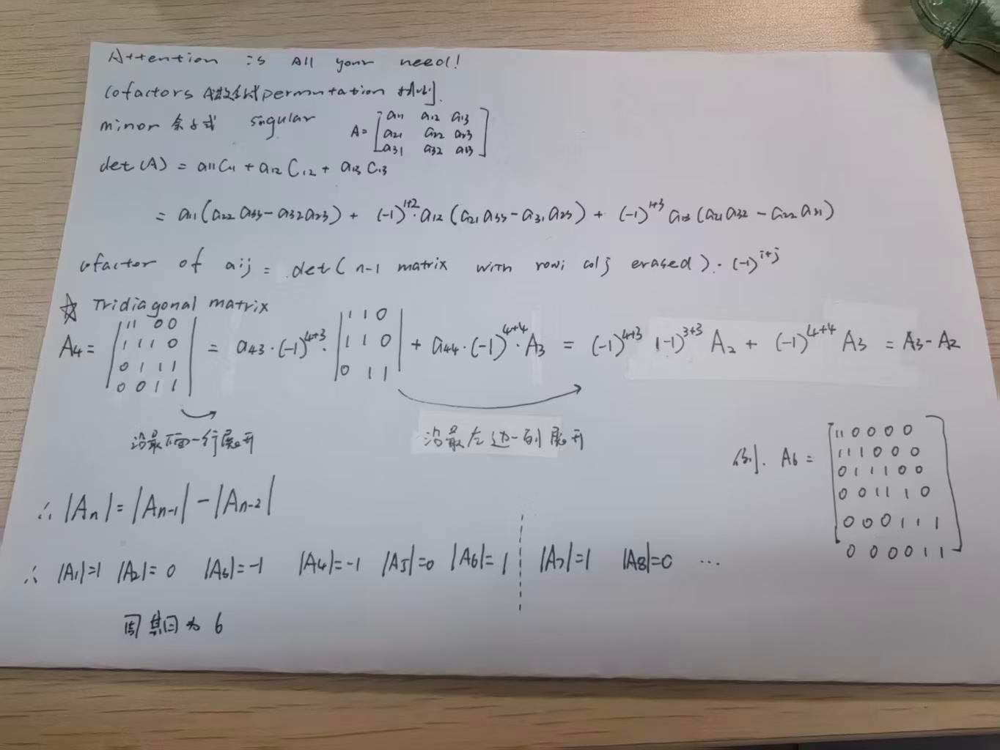

# Determinants

## 本章主线与范围

前面已经用 rank、pivot、null space 和列空间判断方阵是否可逆。本章引入一个新的标量：**determinant（行列式）**。它用“是否为零”判别方阵是否可逆，并描述线性变换对有向面积或体积的缩放。但它不能给出全部结构：determinant 为零时，仍不能仅凭这个数确定具体的 rank。

```text
三个基本性质
    -> 相关行使 determinant 为零，行替换不改变 determinant
    -> 三角矩阵的对角线乘积与消元计算
    -> det(A)=0 当且仅当 A singular
    -> 用初等行操作证明乘法性质
    -> LU / PA=LU 记录消元，并用于证明转置性质
    -> 行列对称，建立 minor、cofactor 与任意行列展开
    -> 三对角矩阵：稀疏展开 -> 递推 -> 周期 -> 可逆性判别
    -> 伴随矩阵：对角项展开 / 非对角项重复行 -> 逆矩阵公式
    -> 解 Ax=b：取解的分量 -> 换列展开 -> Cramer's Rule
```

本章与上一章的两种分解要区分：

| 分解 | 来源 | 主要作用 |
| --- | --- | --- |
| $`A=QR`$ | Gram–Schmidt 正交化 | 用标准正交基描述列空间 |
| $`A=LU`$ | Gaussian elimination 高斯消元 | 记录消元倍数并快速求解方程或 determinant |

> **先记住：$`\det(A)`$ 是一个数，不是一个矩阵；通常只对方阵定义 determinant。**

## 一、determinant 是什么

### 1. 输入是方阵，输出是标量

若

```math
A\in\mathbb{R}^{n\times n},
```

则

```math
\det(A)\in\mathbb{R}.
```

因此 $`\det`$ 是一个把方阵映射到实数的函数：

```math
\det:\mathbb{R}^{n\times n}\longrightarrow\mathbb{R}.
```

当 $`m\neq n`$ 时，非方阵没有通常意义下的 determinant。它可以讨论 rank、null space 或列空间，但不能直接写 $`\det(A)`$。

### 2. 二阶行列式

对于

```math
A=
\begin{bmatrix}
a&b\\
c&d
\end{bmatrix},
```

有

```math
\boxed{
\det(A)=ad-bc
}.
```

例如

```math
A=
\begin{bmatrix}
2&1\\
4&3
\end{bmatrix},
```

则

```math
\det(A)=2\cdot3-1\cdot4=2.
```

### 3. 几何意义：有向体积缩放因子

若 $`A`$ 是二维线性变换，则 $`|\det(A)|`$ 表示面积被放大的倍数；在三维中，它表示体积被放大的倍数。

- $`|\det(A)|>1`$：面积或体积被放大；
- $`0<|\det(A)|<1`$：面积或体积被压缩；
- $`\det(A)<0`$：除缩放外还发生了方向翻转；
- $`\det(A)=0`$：某个维度被压扁，体积塌为零。

最后一种情况正对应矩阵丢失信息、不可逆。

## 二、determinant 的三个基本性质

在课程中，可以从下面三条基本性质出发理解 determinant。后面很多规则都不是新的公理，而是由这些性质推导出来的。

### 1. 单位矩阵的 determinant 是 1

```math
\boxed{\det(I_n)=1}.
```

单位矩阵不改变向量，也不改变有向体积，所以缩放因子为 1。

### 2. 交换任意两行，determinant 变号

若 $`B`$ 由 $`A`$ 交换任意两行得到，则

```math
\boxed{\det(B)=-\det(A)}.
```

这里不要求交换相邻行。若一共交换 $`s`$ 次，则

```math
\det(B)=(-1)^s\det(A).
```

因此：

- 偶数次交换不改变最终符号；
- 奇数次交换使最终结果变号。

### 3. determinant 对每一行分别线性

固定其他行，只改变其中一行时，determinant 对这一行满足线性性。

若某一行乘以 $`c`$，则

```math
\det
\begin{bmatrix}
\vdots\\
cR_i\\
\vdots
\end{bmatrix}
=
c\det
\begin{bmatrix}
\vdots\\
R_i\\
\vdots
\end{bmatrix}.
```

若某一行是 $`u+v`$，则

```math
\det
\begin{bmatrix}
\vdots\\
u+v\\
\vdots
\end{bmatrix}
=
\det
\begin{bmatrix}
\vdots\\
u\\
\vdots
\end{bmatrix}
+
\det
\begin{bmatrix}
\vdots\\
v\\
\vdots
\end{bmatrix}.
```

拆分某一行时，其他所有行必须保持相同。这种“对每一行分别线性”的性质称为 **multilinearity（多重线性）**。它不表示 determinant 对整个矩阵线性。列的对应结论将在第七节由转置性质统一推出。

## 三、由基本性质推出行操作规则

### 1. 两行相同，则 determinant 为零

假设 $`A`$ 有两行完全相同。交换这两行后矩阵没有变化，因此 determinant 也应保持不变；但交换性质又要求它变号：

```math
\det(A)=-\det(A).
```

所以

```math
2\det(A)=0,
```

即

```math
\boxed{\det(A)=0}.
```

### 2. 两行成倍数或有一行全零，则 determinant 为零

若

```math
R_j=cR_i,
```

则从第 $`j`$ 行提出 $`c`$ 后，矩阵出现两行相同，所以

```math
\boxed{\det(A)=0}.
```

零行是这个结论的特殊情况。若某一行全为零，也可以直接从这一行提出系数 0，因此 determinant 为 0。

### 3. 从两行相关推广到整组行相关

若各行线性相关，存在不全为零的系数，使

```math
\sum_{i=1}^n c_iR_i=\mathbf0.
```

选一个 $`c_j\neq0`$，便能把该行写成其他行的线性组合：

```math
R_j=-\sum_{i\neq j}\frac{c_i}{c_j}R_i.
```

对第 $`j`$ 行用 multilinearity 展开。每个非零项都把这一行替换为某个已有的 $`R_i`$，因此出现两行相同，每项 determinant 都为零。若该行本来就是零行，结论也成立。所以

```math
\boxed{\text{各行线性相关}\Longrightarrow\det(A)=0}.
```

第五节会用消元证明反方向；列相关的对应结论将在第七节推出。

### 4. 一行加上另一行的倍数，determinant 不变

考虑行替换

```math
R_j\leftarrow R_j+cR_i,
\qquad i\neq j.
```

利用对第 $`j`$ 行的线性性：

```math
\det
\begin{bmatrix}
\vdots\\
R_i\\
\vdots\\
R_j+cR_i\\
\vdots
\end{bmatrix}
=
\det
\begin{bmatrix}
\vdots\\
R_i\\
\vdots\\
R_j\\
\vdots
\end{bmatrix}
+c
\det
\begin{bmatrix}
\vdots\\
R_i\\
\vdots\\
R_i\\
\vdots
\end{bmatrix}.
```

第二个 determinant 有两行相同，所以等于 0。于是

```math
\boxed{
R_j\leftarrow R_j+cR_i
\quad\Longrightarrow\quad
\det\text{ 不变}
}.
```

### 5. 三种初等行操作的影响

| 行操作 | determinant 的变化 |
| --- | --- |
| $`R_i\leftrightarrow R_j`$ | 乘 $`-1`$ |
| $`R_i\leftarrow cR_i`$ | 乘 $`c`$ |
| $`R_j\leftarrow R_j+cR_i`$，$`i\neq j`$ | 不变 |

这张表是消元计算时必须全程追踪的规则。缩放性质允许 $`c=0`$，但若要把行缩放当作**可逆的初等行操作**，必须要求 $`c\neq0`$。高斯消元使用的是可逆行操作。

## 四、三角矩阵与高斯消元

### 1. 三角矩阵的 determinant

若 $`U`$ 是上三角矩阵：

```math
U=
\begin{bmatrix}
d_1&*&\cdots&*\\
0&d_2&\cdots&*\\
\vdots&\ddots&\ddots&\vdots\\
0&\cdots&0&d_n
\end{bmatrix},
```

则

```math
\boxed{
\det(U)=d_1d_2\cdots d_n
}.
```

为什么只剩对角线乘积？把各行按标准行向量 $`e_j^T`$ 拆开，用 multilinearity 展开。上三角矩阵最后一行只能贡献 $`d_ne_n^T`$；倒数第二行若也选择 $`e_n^T`$，就出现相同行，该项为零。因此它只能贡献 $`d_{n-1}e_{n-1}^T`$。依次向上推，唯一可能留下的项是

```math
d_1d_2\cdots d_n\det(I_n)=d_1d_2\cdots d_n.
```

即使某个 $`d_i=0`$，这个推导仍成立，不需要除以对角元素。下三角矩阵从第一行开始做同样的论证，也得到主对角线乘积。这里不需要提前使用 cofactor 或转置性质。

这里的 $`d_i`$ 是三角矩阵的对角元素。若 $`U`$ 是消元得到的阶梯形矩阵且 $`A`$ 可逆，它们也就是非零 pivots。

### 2. 用消元计算 determinant

考虑

```math
A=
\begin{bmatrix}
2&1\\
4&3
\end{bmatrix}.
```

执行

```math
R_2\leftarrow R_2-2R_1
```

得到

```math
U=
\begin{bmatrix}
2&1\\
0&1
\end{bmatrix}.
```

这一步只是把另一行的倍数加到第 2 行，所以 determinant 不变：

```math
\det(A)=\det(U)=2\cdot1=2.
```

若消元过程中交换了 $`s`$ 次行，并且没有进行行缩放，则

```math
\boxed{
\det(A)=(-1)^s\prod_{i=1}^n d_i
}.
```

其中 $`d_i`$ 是最终上三角矩阵的对角元素。

### 3. 为什么不能无条件说“determinant 等于 pivot 乘积”

必须检查消元过程中做过什么：

- 行替换不改变 determinant；
- 每次换行要补一个负号；
- 若把某行乘以 $`c`$，必须把这个因子计入；
- 若把 pivot 行除以 pivot，使 pivot 变成 1，也必须把这个缩放还原。

因此，更准确的说法是：

> **当消元只使用行替换和换行时，$`\det(A)`$ 等于换行符号乘以上三角矩阵的对角线乘积。**

若还进行了 $`t`$ 次非零行缩放，系数为 $`c_1,\ldots,c_t`$，则

```math
\det(U)=(-1)^s(c_1\cdots c_t)\det(A),
```

所以

```math
\boxed{\det(A)=\frac{(-1)^s\prod_{i=1}^n u_{ii}}{c_1\cdots c_t}}.
```

例如 $`\begin{bmatrix}0&1\\1&2\end{bmatrix}`$ 换一次行后成为 $`\begin{bmatrix}1&2\\0&1\end{bmatrix}`$，所以原矩阵的 determinant 是 $`-1`$，而不是 $`1`$。

## 五、singular 与 invertible 的分类

对 $`n\times n`$ 方阵，只有两种可能：

```text
A singular：不可逆
A nonsingular / invertible：可逆
```

### 1. singular 情况

以下消元只用行替换和必要的换行，不把 pivot 单位化。

若 $`A`$ singular，则

```math
\mathrm{rank}(A)<n.
```

消元后不足 $`n`$ 个 pivots，所以阶梯形中一定出现零行：

```math
U=
\begin{bmatrix}
*&*&*\\
0&*&*\\
0&0&0
\end{bmatrix}.
```

三角矩阵至少有一个对角元素为 0，因此

```math
\det(U)=0.
```

换行只能改变符号，行替换不改变 determinant；无论怎样都不能把 0 变成非零数。所以

```math
\boxed{
A\text{ singular}
\quad\Longrightarrow\quad
\det(A)=0
}.
```

### 2. invertible 情况

若 $`A`$ 可逆，则

```math
\mathrm{rank}(A)=n.
```

消元时会得到 $`n`$ 个非零 pivots：

```math
U=
\begin{bmatrix}
d_1&*&*\\
0&d_2&*\\
0&0&d_3
\end{bmatrix},
\qquad
d_i\neq0.
```

所以

```math
\det(A)
=(-1)^s d_1d_2\cdots d_n
\neq0.
```

因此

```math
\boxed{
A\text{ invertible}
\quad\Longrightarrow\quad
\det(A)\neq0
}.
```

singular 与 invertible 已经覆盖所有方阵：前者的 determinant 为 0，后者的 determinant 非零。因此

```math
\boxed{
A\text{ singular}
\quad\Longleftrightarrow\quad
\det(A)=0
}.
```

### 3. 与前面知识的完整等价链

对 $`n\times n`$ 方阵 $`A`$：

```math
\boxed{
\begin{aligned}
A\text{ invertible}
&\Longleftrightarrow \det(A)\neq0\\
&\Longleftrightarrow \mathrm{rank}(A)=n\\
&\Longleftrightarrow A\text{ 有 }n\text{ 个 pivots}\\
&\Longleftrightarrow N(A)=\{\mathbf0\}\\
&\Longleftrightarrow A\text{ 的列线性无关}\\
&\Longleftrightarrow \mathrm{Col}(A)=\mathbb{R}^n\\
&\Longleftrightarrow A\mathbf{x}=\mathbf{b}
\text{ 对每个 }\mathbf{b}\text{ 都有唯一解}.
\end{aligned}
}
```

singular 情况就是这些条件的反面：

```math
\boxed{
A\text{ singular}
\Longleftrightarrow
\det(A)=0
\Longleftrightarrow
\mathrm{rank}(A)<n
\Longleftrightarrow
N(A)\neq\{\mathbf0\}
}.
```

需要注意：当 $`A`$ singular 时，$`A\mathbf{x}=\mathbf{b}`$ 可能无解，也可能有无穷多解；它不可能对每个 $`\mathbf{b}`$ 都有唯一解。

> 老师的 case split 可以概括为：singular 时消元会出现零行；invertible 时会得到 $`n`$ 个非零 pivots，其乘积给出非零 determinant。

## 六、determinant 的乘法与缩放性质

### 1. 乘积的 determinant

对同阶方阵 $`A,B`$：

```math
\boxed{
\det(AB)=\det(A)\det(B)
}.
```

这表示连续做两个线性变换时，有向体积缩放因子相乘。下面直接由行操作证明，不先假设 LU 公式。

**第一步：一次行操作。** 初等矩阵 $`E`$ 是对 $`I_n`$ 做一次可逆行操作得到的矩阵。行操作表说明，对任意同阶矩阵 $`M`$，

```math
\det(EM)=\det(E)\det(M).
```

这里 $`\det(E)`$ 恰好是该操作的变化因子：$`-1`$、非零缩放系数或 $`1`$。

**第二步：$`A`$ 可逆时。** 把它消元到单位矩阵：

```math
E_k\cdots E_1A=I_n,\qquad
\gamma=\prod_{\ell=1}^k\det(E_\ell)\neq0.
```

逐次使用第一步的规则，得到 $`1=\gamma\det(A)`$。对 $`AB`$ 做完全相同的操作：

```math
E_k\cdots E_1(AB)=B,\qquad
\det(B)=\gamma\det(AB).
```

代入 $`\gamma=1/\det(A)`$，便得到乘法公式。这里不要求 $`B`$ 可逆。

**第三步：$`A`$ singular 时。** $`AB`$ 的每一列都是 $`A`$ 各列的线性组合，所以

```math
\mathrm{Col}(AB)\subseteq\mathrm{Col}(A),\qquad
\mathrm{rank}(AB)\leq\mathrm{rank}(A)<n.
```

第五节说明 $`\det(AB)=0`$；同时 $`\det(A)=0`$。公式两边都为零，仍成立。这样就覆盖了所有同阶方阵，并为后面的 $`\det(LU)`$ 提供依据。

矩阵乘法一般不满足 $`AB=BA`$，但 determinant 是数，因此

```math
\det(AB)
=\det(A)\det(B)
=\det(B)\det(A)
=\det(BA).
```

所以对同阶方阵，即使 $`AB\neq BA`$，也总有

```math
\det(AB)=\det(BA).
```

### 2. 幂与逆矩阵

由乘法性质：

```math
\det(A^2)
=\det(A)\det(A)
=\bigl(\det(A)\bigr)^2.
```

更一般地，正整数 $`k`$ 满足

```math
\det(A^k)=\bigl(\det(A)\bigr)^k.
```

若 $`A`$ 可逆，则

```math
1
=\det(I)
=\det(AA^{-1})
=\det(A)\det(A^{-1}),
```

因此

```math
\boxed{
\det(A^{-1})=\frac{1}{\det(A)}
}.
```

### 3. 整个矩阵乘常数

若 $`A`$ 是 $`n\times n`$ 方阵，则 $`cA`$ 把 $`A`$ 的每一行都乘以 $`c`$。一共有 $`n`$ 行，所以

```math
\boxed{
\det(cA)=c^n\det(A)
}.
```

例如，对于 $`3\times3`$ 矩阵：

```math
\det(2A)=2^3\det(A)=8\det(A).
```

必须区分：

- 只把一行乘 $`c`$：determinant 乘 $`c`$；
- 把整个 $`n\times n`$ 矩阵乘 $`c`$：determinant 乘 $`c^n`$。

### 4. 多重线性不等于对整个矩阵线性

一般不能写 $`\det(A+B)=\det(A)+\det(B)`$。例如 $`A=B=I_2`$：

```math
\det(A+B)=\det(2I_2)=4,\qquad
\det(A)+\det(B)=2.
```

一行线性性的前提是**其余所有行固定**；整个矩阵相加时，每一行都在改变，不能套用这一前提。

## 七、LU 分解与转置性质

### 1. $`A=LU`$ 不是 determinant 的定义

```math
\boxed{A=LU}
```

是矩阵分解，不是 determinant 的公理。它把高斯消元

```math
A\longrightarrow U
```

中使用的消元倍数记录到下三角矩阵 $`L`$ 中：

- $`U`$：消元后的上三角矩阵；
- $`L`$：记录 elimination multipliers 的单位下三角矩阵。

### 2. 从 elimination matrix 推出 $`A=LU`$

仍取

```math
A=
\begin{bmatrix}
2&1\\
4&3
\end{bmatrix}.
```

行操作

```math
R_2\leftarrow R_2-2R_1
```

可以写成左乘 elimination matrix：

```math
E=
\begin{bmatrix}
1&0\\
-2&1
\end{bmatrix},
\qquad
EA=U.
```

这里

```math
U=
\begin{bmatrix}
2&1\\
0&1
\end{bmatrix}.
```

由 $`EA=U`$ 得

```math
A=E^{-1}U.
```

定义

```math
L=E^{-1}
=
\begin{bmatrix}
1&0\\
2&1
\end{bmatrix},
```

于是

```math
\boxed{A=LU}.
```

直接验证：

```math
\begin{bmatrix}
1&0\\
2&1
\end{bmatrix}
\begin{bmatrix}
2&1\\
0&1
\end{bmatrix}
=
\begin{bmatrix}
2&1\\
4&3
\end{bmatrix}.
```

$`L`$ 左下角的 2，正是消元时使用的倍数。

### 3. 多步消元

若向下消元只用行替换，不换行也不缩放 pivot 行，各个 $`E_i`$ 都是单位下三角矩阵。若连续消元满足

```math
E_k\cdots E_2E_1A=U,
```

则

```math
A
=E_1^{-1}E_2^{-1}\cdots E_k^{-1}U.
```

把前面的逆矩阵乘积记为

```math
L=E_1^{-1}E_2^{-1}\cdots E_k^{-1},
```

这些逆矩阵及其乘积仍是单位下三角矩阵，因此 $`L`$ 的结构并非任意指定。于是得到

```math
\boxed{A=LU}.
```

这说明：

```math
\boxed{
LU\text{ 分解是 Gaussian elimination 的矩阵化记录}
}.
```

### 4. 需要换行时：$`PA=LU`$

并不是每个矩阵都能在完全不换行的情况下直接得到普通的 $`A=LU`$。例如

```math
A=
\begin{bmatrix}
0&1\\
1&2
\end{bmatrix}
```

的第一个候选 pivot 是 0，必须先交换两行。令

```math
P=
\begin{bmatrix}
0&1\\
1&0
\end{bmatrix},
```

则更一般的分解写成

```math
\boxed{PA=LU}.
```

这个例子可以取

```math
L=I_2,\qquad U=PA=\begin{bmatrix}1&2\\0&1\end{bmatrix}.
```

$`P`$ 是 permutation matrix（置换矩阵），记录消元过程中的换行。实际数值计算通常使用这种带 pivoting 的形式。

### 5. LU 怎样帮助计算 determinant

在不换行的 $`A=LU`$ 中，$`L`$ 通常是单位下三角矩阵，所以

```math
\det(L)=1.
```

应用第六节已经证明的乘法性质：

```math
\det(A)
=\det(L)\det(U)
=\det(U)
=\prod_{i=1}^n u_{ii}.
```

若

```math
PA=LU
```

并且 $`P`$ 记录了 $`s`$ 次换行，则

```math
\det(P)=(-1)^s.
```

由

```math
\det(P)\det(A)=\det(L)\det(U)
```

得到

```math
\boxed{
\det(A)=(-1)^s\prod_{i=1}^n u_{ii}
}.
```

所以逻辑顺序是：先对矩阵做 LU 分解，再对等式两边取 determinant；不是“把 determinant 分解成 LU”。

### 6. 转置不改变 determinant

```math
\boxed{
\det(A^T)=\det(A)
}.
```

这条性质说明 determinant 对行与列是对称的。前面对行得到的规则，也都可以改写成对应的列规则。

可以按 singular 与 invertible 分两种情况理解。

#### 情况一：$`A`$ singular

因为

```math
\mathrm{rank}(A^T)=\mathrm{rank}(A)<n,
```

所以 $`A^T`$ 也 singular。因此

```math
\det(A)=\det(A^T)=0.
```

#### 情况二：$`A`$ invertible

用带换行的 LU 分解写成

```math
PA=LU.
```

由于 $`P^{-1}=P^T`$，有

```math
A=P^TLU.
```

转置后：

```math
A^T=U^TL^TP.
```

上三角矩阵转置后变成下三角矩阵，但主对角线不变，所以

```math
\det(U^T)=\det(U),
\qquad
\det(L^T)=\det(L).
```

置换矩阵 $`P`$ 与 $`P^T`$ 记录相同的交换奇偶性，因此

```math
\det(P^T)=\det(P).
```

于是

```math
\begin{aligned}
\det(A^T)
&=\det(U^T)\det(L^T)\det(P)\\
&=\det(U)\det(L)\det(P)\\
&=\det(P^T)\det(L)\det(U)\\
&=\det(A).
\end{aligned}
```

若消元不需要换行，$`P=I`$，上面的证明就简化为老师板书中的

```math
A=LU,
\qquad
A^T=U^TL^T.
```

转置把列操作变成行操作，因此对列也分别线性：两列相同、列相关或零列使 determinant 为零；交换两列变号；一列加另一列的倍数不改变 determinant。

至此，行与列的对称性有了依据。下一节可以选择“沿行展开”或“沿列展开”。

## 八、minor、cofactor 与展开公式

高斯消元通过 $`A\to U`$ 计算 determinant。现在介绍另一种方法：把一个 $`n\times n`$ determinant 拆成若干个 $`(n-1)\times(n-1)`$ determinant。这就是 **cofactor expansion（代数余子式展开）**。

先区分子矩阵与两个标量，再学习展开公式及其来源，最后把它应用到稀疏矩阵。课堂草稿原图放在第九节的完整例题中。

### 1. 先区分三个对象

设

```math
A=(a_{ij})\in\mathbb{R}^{n\times n}.
```

关注元素 $`a_{ij}`$ 时，按下面三步定义。

以下删行删列的例子先考虑 $`n\geq2`$。一阶矩阵直接有 $`\det[a_{11}]=a_{11}`$；若希望 cofactor 定义和展开式也统一包含一阶情况，约定空的 $`0\times0`$ 矩阵的 determinant 为 1，于是 $`C_{11}=1`$。

第一步，删掉 $`a_{ij}`$ 所在的第 $`i`$ 行和第 $`j`$ 列，得到一个 $`(n-1)\times(n-1)`$ **submatrix（子矩阵）**，记为

```math
A^{(ij)}.
```

第二步，对这个子矩阵取 determinant：

```math
\boxed{
M_{ij}=\det\bigl(A^{(ij)}\bigr)
}.
```

$`M_{ij}`$ 称为 $`a_{ij}`$ 的 **minor（余子式）**。

第三步，为 minor 加上位置决定的符号：

```math
\boxed{
C_{ij}=(-1)^{i+j}M_{ij}
}.
```

$`C_{ij}`$ 称为 $`a_{ij}`$ 的 **cofactor（代数余子式）**。

因此逻辑顺序是：

```text
删除第 i 行与第 j 列
    -> 得到 submatrix A^(ij)
    -> 对子矩阵取 determinant，得到 minor M_ij
    -> 乘 (-1)^(i+j)，得到 cofactor C_ij
```

> **子矩阵是一个矩阵，minor 与 cofactor 都是数。minor 还没有位置符号，cofactor 才包含 $`(-1)^{i+j}`$。**

### 2. 一个具体位置：$`a_{12}`$

设

```math
A=
\begin{bmatrix}
a_{11}&a_{12}&a_{13}\\
a_{21}&a_{22}&a_{23}\\
a_{31}&a_{32}&a_{33}
\end{bmatrix}.
```

$`a_{12}`$ 位于第 1 行、第 2 列。删掉这一行和这一列后，剩下

```math
A^{(12)}=
\begin{bmatrix}
a_{21}&a_{23}\\
a_{31}&a_{33}
\end{bmatrix}.
```

所以它的 minor 是

```math
M_{12}
=
\det
\begin{bmatrix}
a_{21}&a_{23}\\
a_{31}&a_{33}
\end{bmatrix}.
```

因为 $`1+2=3`$ 是奇数，所以

```math
\boxed{
C_{12}
=-
\det
\begin{bmatrix}
a_{21}&a_{23}\\
a_{31}&a_{33}
\end{bmatrix}
}.
```

### 3. cofactor 的棋盘格符号

$`(-1)^{i+j}`$ 产生交替出现的正负号：

```math
\boxed{
\begin{bmatrix}
+&-&+&-&\cdots\\
-&+&-&+&\cdots\\
+&-&+&-&\cdots\\
-&+&-&+&\cdots\\
\vdots&\vdots&\vdots&\vdots&\ddots
\end{bmatrix}
}.
```

左上角 $`(1,1)`$ 从正号开始，相邻位置符号相反。例如：

```math
\begin{aligned}
C_{11}&=+M_{11},&
C_{12}&=-M_{12},&
C_{13}&=+M_{13},\\
C_{21}&=-M_{21},&
C_{22}&=+M_{22},&
C_{23}&=-M_{23}.
\end{aligned}
```

### 4. 沿一行展开

固定第 $`i`$ 行，determinant 可以写成这一行各元素与对应 cofactor 的乘积之和：

```math
\boxed{
\det(A)=\sum_{j=1}^{n}a_{ij}C_{ij}
}.
```

例如沿第一行展开：

```math
\det(A)=a_{11}C_{11}+a_{12}C_{12}+\cdots+a_{1n}C_{1n}.
```

对 $`3\times3`$ 矩阵：

```math
\boxed{
\begin{aligned}
\det(A)
={}&a_{11}
\det
\begin{bmatrix}
a_{22}&a_{23}\\
a_{32}&a_{33}
\end{bmatrix}\\
&-a_{12}
\det
\begin{bmatrix}
a_{21}&a_{23}\\
a_{31}&a_{33}
\end{bmatrix}\\
&+a_{13}
\det
\begin{bmatrix}
a_{21}&a_{22}\\
a_{31}&a_{32}
\end{bmatrix}.
\end{aligned}
}
```

把三个二阶 determinant 继续算开，就得到草稿上半页的表达式：

```math
\begin{aligned}
\det(A)
={}&a_{11}(a_{22}a_{33}-a_{23}a_{32})\\
&-a_{12}(a_{21}a_{33}-a_{23}a_{31})\\
&+a_{13}(a_{21}a_{32}-a_{22}a_{31}).
\end{aligned}
```

这里的负号已经包含 $`C_{12}`$ 的位置符号，不能再重复加一个负号。这不是只对三阶成立的口诀，而是任意阶 cofactor expansion 的特例。

### 5. 沿一列展开

也可以固定第 $`j`$ 列：

```math
\boxed{
\det(A)=\sum_{i=1}^{n}a_{ij}C_{ij}
}.
```

因此可以沿任意一行或任意一列展开，最后得到的都是同一个 $`\det(A)`$。实际计算时不必总选第一行。

### 6. 展开公式来自一行的线性性

以 $`3\times3`$ 矩阵的第一行为例：

```math
\begin{bmatrix}a_{11}&a_{12}&a_{13}\end{bmatrix}
=a_{11}\begin{bmatrix}1&0&0\end{bmatrix}
+a_{12}\begin{bmatrix}0&1&0\end{bmatrix}
+a_{13}\begin{bmatrix}0&0&1\end{bmatrix}.
```

determinant 对这一行具有线性性，因此

```math
\begin{aligned}
\det(A)
={}&a_{11}
\det
\begin{bmatrix}
1&0&0\\
a_{21}&a_{22}&a_{23}\\
a_{31}&a_{32}&a_{33}
\end{bmatrix}\\
&+a_{12}
\det
\begin{bmatrix}
0&1&0\\
a_{21}&a_{22}&a_{23}\\
a_{31}&a_{32}&a_{33}
\end{bmatrix}\\
&+a_{13}
\det
\begin{bmatrix}
0&0&1\\
a_{21}&a_{22}&a_{23}\\
a_{31}&a_{32}&a_{33}
\end{bmatrix}.
\end{aligned}
```

还需要解释：为什么拆分后的系数恰好是 cofactor，尤其是 $`(-1)^{i+j}`$ 从哪里来？

一般地，把第 $`i`$ 行拆成 $`\sum_j a_{ij}e_j^T`$。令 $`B_{ij}`$ 为把该行替换成 $`e_j^T`$ 后的矩阵，则

```math
\det(A)=\sum_j a_{ij}\det(B_{ij}).
```

把 $`B_{ij}`$ 的第 $`i`$ 行用 $`i-1`$ 次相邻行交换移到第一行，再把第 $`j`$ 列用 $`j-1`$ 次相邻列交换移到第一列，得到

```math
\widetilde B_{ij}=
\begin{bmatrix}
1&\mathbf0^T\\
v&A^{(ij)}
\end{bmatrix}.
```

总交换次数为 $`i+j-2`$，所以

```math
\det(\widetilde B_{ij})=(-1)^{i+j-2}\det(B_{ij}).
```

用第一行消去 $`v`$，不改变 determinant，得到块对角矩阵 $`\mathrm{diag}(1,A^{(ij)})`$。它的 determinant 为 $`\det(A^{(ij)})`$：第一行固定了标准方向 $`e_1^T`$，对其余行作标准向量展开时，含另一个 $`e_1^T`$ 的项为零，剩余项正好是子矩阵的 determinant。因此

```math
\det(B_{ij})=(-1)^{i+j}\det(A^{(ij)})=C_{ij}.
```

这就得到沿任意一行的展开公式；沿列展开则把这一结论应用到 $`A^T`$。因此：

```math
\boxed{
\text{cofactor expansion 是一行线性拆分后的通用公式}
}.
```

### 7. 数值例题：选择零最多的一行

设

```math
A=
\begin{bmatrix}
5&0&0\\
2&3&7\\
1&4&6
\end{bmatrix}.
```

沿第一行展开：

```math
\begin{aligned}
\det(A)
&=5C_{11}+0C_{12}+0C_{13}\\
&=5
\det
\begin{bmatrix}
3&7\\
4&6
\end{bmatrix}\\
&=5(18-28)\\
&=-50.
\end{aligned}
```

因此：

```math
\boxed{
\text{做 cofactor expansion 时，通常选择零最多的行或列}
}.
```

如果有一整行或一整列全为零，沿它展开时每一项都是零，所以 $`\det(A)=0`$。这里必须说“全是零”，不是“全都非零”。

### 8. 再练一次：求 $`C_{23}`$

设

```math
A=
\begin{bmatrix}
a&b&c\\
d&e&f\\
g&h&i
\end{bmatrix}.
```

$`f=a_{23}`$ 位于第 2 行、第 3 列。删掉第 2 行和第 3 列后：

```math
A^{(23)}=
\begin{bmatrix}
a&b\\
g&h
\end{bmatrix},
\qquad
M_{23}=ah-bg.
```

因为 $`(-1)^{2+3}=-1`$，所以

```math
\boxed{
C_{23}=-(ah-bg)=bg-ah
}.
```

### 9. cofactor expansion 是递归计算

一次展开把 $`n\times n`$ determinant 化为若干个 $`(n-1)\times(n-1)`$ determinant；继续展开，最终降到二阶或一阶：

```text
n x n
    -> (n-1) x (n-1)
    -> (n-2) x (n-2)
    -> ...
    -> 2 x 2
```

这说明 cofactor expansion 是通用算法，但对稠密的大矩阵会产生大量重复计算。

### 10. cofactor expansion 与 elimination 的分工

| 方法 | 思路 | 更适合的情况 |
| --- | --- | --- |
| elimination | $`A\to U`$，追踪换行与缩放，再乘对角线 | 大型数值矩阵、一般计算 |
| cofactor expansion | 沿一行或一列递归拆成更小的 determinant | 小矩阵、零很多的行列、理论推导 |

接下来把展开公式沿两条路线使用：第九节利用稀疏结构推出三对角矩阵的递推；第十、十一节利用展开中的求和构造 adjugate（伴随矩阵），再推导逆矩阵公式与 Cramer's Rule。即使数值计算常用消元，cofactor 仍是理解这些公式来源的关键。

## 九、三对角矩阵：从展开到递推与周期

下面是本次课程的原始推导。上半部分复习三阶 cofactor expansion，下半部分用最后一行展开一个三对角矩阵族，并从中发现 determinant 的递推与周期。



### 1. 明确矩阵族与记号

定义 ### 1. 明确矩阵族与记号

n\times n`$ 三对角矩阵（以下 ### 1. 明确矩阵族与记号

n\geq1`$）

```math
A_n=
\begin{bmatrix}
1&1&0&\cdots&0\\
1&1&1&\ddots&\vdots\\
0&1&1&\ddots&0\\
\vdots&\ddots&\ddots&\ddots&1\\
0&\cdots&0&1&1
\end{bmatrix}.
```

也就是说：

```math
(A_n)_{ij}=
\begin{cases}
1,&|i-j|\leq1,\\
0,&|i-j|>1.
\end{cases}
```

主对角线、上副对角线和下副对角线都是 1，其余位置都是 0。记

```math
D_n=\det(A_n).
```

注意：草稿用 $`|A_n|`$ 表示 determinant，不是 $`|\det(A_n)|`$ 的绝对值。为保留负号而不混淆，本文统一记为 $`D_n`$。“全 1 三对角”只表示三条对角线都是 1，并非整个矩阵全是 1。

草稿中的 $`A_4`$ 是

```math
A_4=
\begin{bmatrix}
1&1&0&0\\
1&1&1&0\\
0&1&1&1\\
0&0&1&1
\end{bmatrix}.
```

最后一行只有最后两个元素非零，这正是使用 cofactor expansion 的理想位置。

### 2. 两次展开推出递推公式

$`A_n`$ 的最后一行只有

```math
a_{n,n-1}=1,
\qquad
a_{n,n}=1
```

两项非零。因此沿最后一行展开：

```math
D_n=C_{n,n-1}+C_{n,n}.
```

先看最后一项。删掉第 $`n`$ 行、第 $`n`$ 列，剩下的正是 $`A_{n-1}`$；而 $`(-1)^{n+n}=1`$，所以

```math
C_{n,n}=D_{n-1}.
```

再看倒数第二项。它的 cofactor 符号是

```math
(-1)^{n+(n-1)}=(-1)^{2n-1}=-1.
```

删掉第 $`n`$ 行和第 $`n-1`$ 列后得到一个 $`(n-1)\times(n-1)`$ 子矩阵。这个子矩阵的最后一列只有最下面的元素为 1；再沿这一列展开，留下的就是 $`A_{n-2}`$。第二次展开的位置为 $`(n-1,n-1)`$，符号为正，因此

```math
C_{n,n-1}=-D_{n-2}.
```

合起来得到：

```math
\boxed{
D_n=D_{n-1}-D_{n-2}
}
\qquad(n\geq3).
```

这就是草稿上

```math
\boxed{|A_n|=|A_{n-1}|-|A_{n-2}|}
```

的来源。

对于 $`A_4`$，两次展开中的符号可以直接写成

```math
\begin{aligned}
D_4
&=(-1)^{4+3}(-1)^{3+3}D_2
+(-1)^{4+4}D_3\\
&=-D_2+D_3\\
&=D_3-D_2.
\end{aligned}
```

把中间矩阵真正写出，就能看清两次符号：

```math
A_4^{(43)}=
\begin{bmatrix}
1&1&0\\
1&1&0\\
0&1&1
\end{bmatrix}.
```

沿它的最后一列展开，只有 $`(3,3)`$ 位置贡献非零项，符号为 $`+`$，留下

```math
\begin{bmatrix}1&1\\1&1\end{bmatrix}=A_2.
```

而 $`A_4^{(44)}=A_3`$。因此第一次展开产生的负号属于 $`C_{43}`$，第二次展开不再变号，最终正是 $`D_4=D_3-D_2`$。这解释了草稿中“沿最后一行展开，再沿最右一列展开”的两步。

### 3. 初值、周期与 singular 情况

前两个 determinant 是

```math
D_1=\det[1]=1,
```

```math
D_2=
\det
\begin{bmatrix}
1&1\\
1&1
\end{bmatrix}
=0.
```

代入递推式：

| $`n`$ | 1 | 2 | 3 | 4 | 5 | 6 | 7 | 8 |
| --- | --- | --- | --- | --- | --- | --- | --- | --- |
| $`D_n`$ | 1 | 0 | -1 | -1 | 0 | 1 | 1 | 0 |

例如：

```math
D_3=D_2-D_1=-1,
```

```math
D_4=D_3-D_2=-1,
```

```math
D_5=D_4-D_3=0,
\qquad
D_6=D_5-D_4=1.
```

递推式还能直接给出周期。因为

```math
\begin{aligned}
D_{n+3}
&=D_{n+2}-D_{n+1}\\
&=(D_{n+1}-D_n)-D_{n+1}\\
&=-D_n,
\end{aligned}
```

所以

```math
D_{n+6}=-D_{n+3}=D_n.
```

因此：

```math
\boxed{D_{n+6}=D_n}.
```

这个 determinant 序列以 6 为周期：

```math
1,\ 0,\ -1,\ -1,\ 0,\ 1,\ldots
```

按 $`n`$ 除以 6 的余数，可以写成

```math
D_n=
\begin{cases}
1,&n\equiv0,1\pmod6,\\
0,&n\equiv2,5\pmod6,\\
-1,&n\equiv3,4\pmod6.
\end{cases}
```

因为方阵 singular 当且仅当 determinant 为 0，所以

```math
\boxed{
A_n\text{ singular}
\quad\Longleftrightarrow\quad
n\equiv2\pmod3
}.
```

草稿右侧的六阶矩阵具体是

```math
A_6=
\begin{bmatrix}
1&1&0&0&0&0\\
1&1&1&0&0&0\\
0&1&1&1&0&0\\
0&0&1&1&1&0\\
0&0&0&1&1&1\\
0&0&0&0&1&1
\end{bmatrix}.
```

因为 $`D_6=1`$，所以 $`A_6`$ 可逆；而 $`D_8=0`$，所以 $`A_8`$ singular。

> **六周期和 $`n\equiv2\pmod3`$ 的判别只适用于这里定义的矩阵族。一般三对角矩阵并没有相同的递推或周期。**

这个例子把本章几条主线连在了一起：

```text
矩阵含有很多 0
    -> 选择最后一行做 cofactor expansion
    -> 得到 determinant 递推
    -> 用初值生成整个序列
    -> determinant 是否为 0 判断矩阵是否 singular
```

## 十、从 cofactor 到伴随矩阵与逆矩阵

第八节的展开公式不仅能计算 determinant，还能构造逆矩阵。本节的任务是把“沿一行展开”写成矩阵乘法，并证明

```math
AC^T=(\det A)I_n.
```

先证明这个恒等式，再在 $`\det(A)\neq0`$ 时推出逆矩阵公式。这个顺序很重要：恒等式对 singular 矩阵也成立，逆矩阵公式则不是。

### 1. cofactor 矩阵与 adjugate：为什么必须转置

设 $`A=(a_{ij})\in\mathbb R^{n\times n}`$。把每个元素对应的 cofactor 按原位置排列，得到 **cofactor matrix（代数余子式矩阵）**：

```math
C=(C_{ij}),\qquad
C_{ij}=(-1)^{i+j}\det\bigl(A^{(ij)}\bigr).
```

对三阶矩阵，

```math
C=
\begin{bmatrix}
C_{11}&C_{12}&C_{13}\\
C_{21}&C_{22}&C_{23}\\
C_{31}&C_{32}&C_{33}
\end{bmatrix},
\qquad
C^T=
\begin{bmatrix}
C_{11}&C_{21}&C_{31}\\
C_{12}&C_{22}&C_{32}\\
C_{13}&C_{23}&C_{33}
\end{bmatrix}.
```

**adjugate（伴随矩阵）**的定义是

```math
\boxed{\mathrm{adj}(A)=C^T}.
```

注意 $`C^T`$ 的第 $`j`$ 列恰好是 $`C`$ 的第 $`j`$ 行转过来的。因此矩阵乘法给出

```math
\boxed{(AC^T)_{ij}=\sum_{k=1}^n a_{ik}C_{jk}}.
```

这里 $`i`$ 决定选取 $`A`$ 的哪一行，$`j`$ 决定选取原矩阵哪一行对应的 cofactor；$`k`$ 遍历这一行的列位置。转置正是为了让“同一行的元素与 cofactor”在对角位置配对。

> **cofactor 矩阵 $`C`$ 与伴随矩阵 $`C^T`$ 不是同一个对象。逆矩阵公式需要的是 $`C^T`$，不能漏掉转置。这里的 adjugate 也不是内积语境中的 adjoint。**

### 2. 对角项：矩阵乘法恰好成为沿原行展开

当 $`i=j`$ 时，

```math
(AC^T)_{ii}=\sum_{k=1}^n a_{ik}C_{ik}.
```

右边正是第八节已经证明的、沿 $`A`$ 第 $`i`$ 行的 cofactor expansion，所以

```math
\boxed{(AC^T)_{ii}=\det(A)}.
```

例如三阶矩阵的左上角：

```math
(AC^T)_{11}
=a_{11}C_{11}+a_{12}C_{12}+a_{13}C_{13}
=\det(A).
```

不是任何“行乘列”都能算出 determinant；是因为 $`C_{ik}`$ 由 $`A`$ 的对应位置专门构造，才使这个点积恰好成为展开公式。

### 3. 非对角项：辅助矩阵为何能证明原来的点积为零

当 $`i\neq j`$ 时，我们要证明

```math
\sum_{k=1}^n a_{ik}C_{jk}(A)=0.
```

这里写 $`C_{jk}(A)`$，明确指出 cofactor 来自原矩阵 $`A`$，避免与新矩阵混淆。

**第一步：另外构造辅助矩阵 $`H`$。** 保持 $`A`$ 的其他行不变，只把第 $`j`$ 行替换成第 $`i`$ 行：

```math
h_{jk}=a_{ik},\qquad
h_{\ell k}=a_{\ell k}\quad(\ell\neq j).
```

$`H`$ 的第 $`i`$ 行和第 $`j`$ 行相同，因而

```math
\det(H)=0.
```

**第二步：说明第 $`j`$ 行对应的 cofactor 不变。** 计算 $`C_{jk}`$ 时，第 $`j`$ 行本来就要被删除。两个矩阵只有这一行不同，删除后得到完全相同的子矩阵；位置符号也相同。因此

```math
\boxed{C_{jk}(H)=C_{jk}(A)\quad\text{对每个 }k}.
```

注意，这里只说**被替换行对应的 cofactor** 不变，其他行的 cofactor 不一定不变。

**第三步：沿 $`H`$ 的第 $`j`$ 行展开，并逐项比较。**

```math
\begin{aligned}
(AC^T)_{ij}
&=\sum_{k=1}^n a_{ik}C_{jk}(A)\\
&=\sum_{k=1}^n h_{jk}C_{jk}(H)\\
&=\det(H)\\
&=0.
\end{aligned}
```

第二个等号是每一项的两个因子分别相等，第三个等号是 cofactor expansion，最后一个等号来自两行相同。这样便严格证明了每个非对角项为零。

> **没有把原来的 $`A`$ 换成 $`H`$，也没有声称 $`AC^T=HC^T`$。我们只证明原乘积中的一个标量 $`(AC^T)_{ij}`$，等于专门构造的 $`\det(H)`$。**

三阶的具体对应关系也可以直接看见。要证明 $`(AC^T)_{12}=0`$，构造

```math
H=
\begin{bmatrix}
a_{11}&a_{12}&a_{13}\\
a_{11}&a_{12}&a_{13}\\
a_{31}&a_{32}&a_{33}
\end{bmatrix}.
```

于是

```math
\begin{aligned}
(AC^T)_{12}
&=a_{11}C_{21}(A)+a_{12}C_{22}(A)+a_{13}C_{23}(A)\\
&=\det(H)=0.
\end{aligned}
```

这不是说每一项乘积都等于零，而是**整行逐项配对后的总和**等于零。

### 4. 二阶矩阵：把完整乘法与辅助构造放在一起

取

```math
A=\begin{bmatrix}a&b\\c&d\end{bmatrix},
\qquad
\det(A)=ad-bc.
```

按定义逐项求 cofactor：

```math
C=\begin{bmatrix}d&-c\\-b&a\end{bmatrix},
\qquad
C^T=\begin{bmatrix}d&-b\\-c&a\end{bmatrix}.
```

所以

```math
\begin{aligned}
AC^T
&=
\begin{bmatrix}
ad-bc&-ab+ba\\
cd-dc&-bc+da
\end{bmatrix}\\
&=(ad-bc)I_2.
\end{aligned}
```

特别地，右上角 $`a(-b)+ba`$ 可以识别为

```math
\det\begin{bmatrix}a&b\\a&b\end{bmatrix}
=a(-b)+ba=0.
```

这里沿辅助矩阵第二行展开；第二行对应的 cofactors 仍为 $`-b,a`$，因为计算时删除的就是第二行。

再用一个非对称的数值矩阵核对，避免转置被对称性掩盖：

```math
A=\begin{bmatrix}2&3\\1&4\end{bmatrix},
\qquad
C=\begin{bmatrix}4&-1\\-3&2\end{bmatrix},
\qquad
C^T=\begin{bmatrix}4&-3\\-1&2\end{bmatrix}.
```

```math
AC^T=
\begin{bmatrix}
2\cdot4+3(-1)&2(-3)+3\cdot2\\
1\cdot4+4(-1)&1(-3)+4\cdot2
\end{bmatrix}
=
\begin{bmatrix}5&0\\0&5\end{bmatrix}.
```

原矩阵 $`\det(A)=5`$，因此结果正是 $`5I_2`$。

### 5. 从恒等式到逆矩阵公式：先检查能否除以 determinant

把对角与非对角两种情况合起来：

```math
(AC^T)_{ij}=
\begin{cases}
\det(A),&i=j,\\
0,&i\neq j.
\end{cases}
```

所以对任意方阵都有

```math
\boxed{A\,\mathrm{adj}(A)=AC^T=(\det A)I_n}.
```

也有反向乘积 $`C^TA=(\det A)I_n`$。可以对 $`A^T`$ 应用同一恒等式：它的 cofactor 矩阵是 $`C^T`$，所以 $`A^TC=(\det A)I_n`$；再转置即得所需结论。

若 $`\det(A)\neq0`$，第五节已经说明 $`A`$ 可逆。由上述恒等式得到

```math
A\left(\frac{C^T}{\det(A)}\right)
=
\left(\frac{C^T}{\det(A)}\right)A
=I_n.
```

这正是逆矩阵的定义，因此

```math
\boxed{A^{-1}=\frac{\mathrm{adj}(A)}{\det(A)}
=\frac{1}{\det(A)}C^T}.
```

二阶情形便还原为熟悉的公式：

```math
\boxed{
\begin{bmatrix}a&b\\c&d\end{bmatrix}^{-1}
=\frac1{ad-bc}
\begin{bmatrix}d&-b\\-c&a\end{bmatrix}
}
\qquad(ad-bc\neq0).
```

若 $`\det(A)=0`$，伴随矩阵仍有定义，恒等式仍成立，但右边成为零矩阵，**不能除以零来得到逆矩阵**。也不能据此断言伴随矩阵本身一定为零。

### 6. 解 $`Ax=b`$：为什么 $`Ix`$ 可以简写为 $`x`$

在 $`A`$ 可逆的前提下，等式两边**左乘** $`A^{-1}`$：

```math
\begin{aligned}
Ax&=b,\\
A^{-1}(Ax)&=A^{-1}b,\\
(A^{-1}A)x&=A^{-1}b,\\
I_nx&=A^{-1}b,\\
x&=A^{-1}b.
\end{aligned}
```

第三步用的是结合律，不是交换律。这里

```math
I_n:n\times n,\qquad
x:n\times1,\qquad
I_nx:n\times1.
```

单位矩阵作用后，结果仍是向量，且不改变任何分量：

```math
I_n
\begin{bmatrix}x_1\\\vdots\\x_n\end{bmatrix}
=
\begin{bmatrix}x_1\\\vdots\\x_n\end{bmatrix}.
```

因此 $`I_nx=x`$，但绝不是 $`I_n=x`$。当 $`n>1`$ 时，把 $`A^{-1}`$ 写到列向量右边通常连尺寸都不匹配；不能把矩阵当作普通数字随意交换位置。

代入逆矩阵公式：

```math
\boxed{x=\frac1{\det(A)}C^Tb}.
```

至此，cofactor 不仅能算 determinant，还能描述逆矩阵作用。下一节从这个向量等式中取出每个分量，得到 Cramer's Rule。

## 十一、Cramer's Rule：从解的分量到换列行列式

### 1. 题目条件与换列矩阵

设

```math
Ax=b,\qquad
A\in\mathbb R^{n\times n},\qquad
\det(A)\neq0.
```

把 $`A`$ 的列记为 $`a_1,\ldots,a_n`$。将第 $`i`$ 列替换成 $`b`$，其余列保持不变，定义

```math
\boxed{B_i=[a_1\ \cdots\ a_{i-1}\ b\ a_{i+1}\ \cdots\ a_n]}.
```

此处 $`B_i`$ 是一个完整的 $`n\times n`$ 矩阵，**不是**删行删列的子矩阵 $`A^{(ij)}`$。有些教材把换列矩阵记为 $`A_i`$，本文用 $`B_i`$，以免与前面的三对角矩阵族 $`A_n`$ 混淆。

要证明的是

```math
\boxed{x_i=\frac{\det(B_i)}{\det(A)},\qquad i=1,\ldots,n}.
```

这就是 **Cramer's Rule（克拉默法则）**。

### 2. 从 $`C^Tb`$ 中读出第 $`i`$ 个分量

上一节已经得到

```math
x=\frac1{\det(A)}C^Tb.
```

$`C^T`$ 的第 $`i`$ 行是 $`C`$ 的第 $`i`$ 列转过来的：

```math
(C^T)_{ik}=C_{ki}.
```

因此

```math
\boxed{x_i=\frac{\sum_{k=1}^n C_{ki}(A)b_k}{\det(A)}}.
```

三阶矩阵的第一个分量具体为

```math
x_1=
\frac{b_1C_{11}+b_2C_{21}+b_3C_{31}}{\det(A)}.
```

这里 cofactor 的**第二个下标固定为 1**，所以分子对应原矩阵的第一列，而不是第一行。

> 课堂原话（按提供材料）：“I'm taking the first entry of b times what? Times the cofactor C11.”
>
> 这是在逐项计算 $`C^T`$ 的第一行与 $`b`$ 的点积：$`b_1`$ 配 $`C_{11}`$，接着 $`b_2`$ 配 $`C_{21}`$，而不是 $`C_{12}`$。

### 3. 分子为何恰好是 $`\det(B_i)`$

沿 $`B_i`$ 的第 $`i`$ 列展开：

```math
\det(B_i)=\sum_{k=1}^n b_kC_{ki}(B_i).
```

为什么能使用原矩阵 $`A`$ 的 cofactor？因为求第 $`i`$ 列的 cofactor 时，这一列本来就会被删除。$`A`$ 与 $`B_i`$ 只有这一列不同，所以

```math
\boxed{C_{ki}(B_i)=C_{ki}(A)\quad\text{对每个 }k}.
```

于是严格得到

```math
\begin{aligned}
\det(B_i)
&=\sum_{k=1}^n b_kC_{ki}(B_i)\\
&=\sum_{k=1}^n b_kC_{ki}(A).
\end{aligned}
```

这与 $`x_i`$ 的分子逐项相同，因而

```math
\boxed{x_i=\frac{\det(B_i)}{\det(A)}}.
```

以三阶的 $`i=1`$ 为例，换列矩阵是

```math
B_1=
\begin{bmatrix}
b_1&a_{12}&a_{13}\\
b_2&a_{22}&a_{23}\\
b_3&a_{32}&a_{33}
\end{bmatrix}.
```

沿第一列展开，得到的正是 $`b_1C_{11}+b_2C_{21}+b_3C_{31}`$。

这与上一节的辅助矩阵证明使用同一种方法：**先按矩阵乘法得到一个标量求和，再构造矩阵，证明该求和严格等于它的 cofactor expansion。** 不是替换原来的矩阵乘法，而是识别同一个标量的另一种表达。

### 4. 用列线性性再核对一次

还可以直接从你熟悉的列组合出发：

```math
b=Ax=\sum_{j=1}^n x_ja_j.
```

将这个式子代入 $`B_i`$ 的第 $`i`$ 列，并对该列使用 multilinearity：

```math
\det(B_i)
=\sum_{j=1}^n x_j
\det[a_1\ \cdots\ a_{i-1}\ a_j\ a_{i+1}\ \cdots\ a_n].
```

当 $`j\neq i`$ 时，矩阵含有两列 $`a_j`$，对应项为零；只有 $`j=i`$ 时留下原矩阵 $`A`$。因此

```math
\boxed{\det(B_i)=x_i\det(A)}.
```

当 $`\det(A)\neq0`$，除以它就再次得到 Cramer 法则。这个证明把法则直接接回“矩阵乘向量就是列的线性组合”，也解释了为什么替换的是列。

### 5. 完整数值例题：逆矩阵、换列与代回验证

解

```math
A=\begin{bmatrix}2&1\\1&3\end{bmatrix},
\qquad
b=\begin{bmatrix}5\\7\end{bmatrix},
\qquad
Ax=b.
```

**先检查条件。**

```math
\det(A)=2\cdot3-1\cdot1=5\neq0.
```

所以方程有唯一解，逆矩阵公式与 Cramer 法则均可使用。

**方法一：逆矩阵公式。**

```math
C=\begin{bmatrix}3&-1\\-1&2\end{bmatrix},
\qquad
A^{-1}=\frac15C^T.
```

本例 $`C`$ 恰好对称，但一般情况下仍必须转置。于是

```math
x=\frac15
\begin{bmatrix}3&-1\\-1&2\end{bmatrix}
\begin{bmatrix}5\\7\end{bmatrix}
=\frac15\begin{bmatrix}8\\9\end{bmatrix}.
```

**方法二：逐列替换。**

```math
B_1=\begin{bmatrix}5&1\\7&3\end{bmatrix},
\qquad
\det(B_1)=15-7=8;
```

```math
B_2=\begin{bmatrix}2&5\\1&7\end{bmatrix},
\qquad
\det(B_2)=14-5=9.
```

所以

```math
\boxed{x_1=\frac85,\qquad x_2=\frac95}.
```

两个分子分别对应同一个 cofactor 求和：

```math
\det(B_1)=5C_{11}+7C_{21}=15-7=8,
```

```math
\det(B_2)=5C_{12}+7C_{22}=-5+14=9.
```

**最后代回原方程。**

```math
A\begin{bmatrix}8/5\\9/5\end{bmatrix}
=
\begin{bmatrix}
2(8/5)+9/5\\
8/5+3(9/5)
\end{bmatrix}
=
\begin{bmatrix}5\\7\end{bmatrix}=b.
```

### 6. 条件与计算方法的边界

$`\det(A)\neq0`$ 是逆矩阵公式和 Cramer 比值公式的共同前提。若 $`A`$ singular，这两个比值公式不能使用；原方程是否有解仍应检查 $`b\in\mathrm{Col}(A)`$，不能从 $`0/0`$ 推出一个解。

Cramer 法则适合小规模手算和理论推导。一般数值求解 $`Ax=b`$ 时，仍优先使用消元或 LU，不必先构造整个逆矩阵，也不必为每个分量重复计算一个 determinant。

本次推导的完整链路是：

```text
cofactor expansion
    -> AC^T 的对角项是 det(A)
    -> 非对角项等于两行相同辅助矩阵的 determinant，为 0
    -> AC^T=(det A)I
    -> det(A) 非零时：A^(-1)=C^T/det(A)
    -> 左乘逆矩阵：Ix=A^(-1)b -> x=A^(-1)b
    -> x_i 的分子等于换列矩阵 B_i 的 determinant
    -> x_i=det(B_i)/det(A)
```

## 十二、常见混淆与修正

| 容易混淆的说法 | 正确限定 |
| --- | --- |
| “行列式分解成 LU” | 是矩阵 $`A`$ 分解为 $`LU`$ 或 $`P^TLU`$，再取 determinant |
| “每个方阵都能直接做无换行 LU” | 普通 LU 有条件；带行置换的形式是 $`PA=LU`$ |
| “远距离交换两行不止变一次号” | 直接交换任意两行都乘 $`-1`$；拆成相邻交换时看整体奇偶性 |
| “消元后直接乘 pivots” | 必须修正换行和非零行缩放；singular 时还要包括为零的对角元素 |
| “$`\det(cA)=c\det(A)`$” | 对 $`n\times n`$ 方阵是 $`c^n\det(A)`$；只缩放一行才乘 $`c`$ |
| “对行线性，所以对矩阵加法也线性” | 一行线性要求其他行固定；一般 $`\det(A+B)\neq\det(A)+\det(B)`$ |
| “minor 就是删行删列的矩阵” | 删行删列得到子矩阵；minor 是它的 determinant；cofactor 再乘位置符号 |
| “只能沿第一行展开” | 可以选任意行或列；优先选零最多的 |
| “$`D_n`$ 等于零能告诉我确切 rank” | 只能直接说明 rank 小于 $`n`$，具体 rank 还需另行判断 |
| “三对角矩阵行列式都六周期” | 六周期只属于本节特定的三条对角线全为 1 的矩阵族 |
| “cofactor 矩阵就是伴随矩阵” | $`C=(C_{ij})`$ 是 cofactor 矩阵；$`\mathrm{adj}(A)=C^T`$ 才是伴随矩阵 |
| “非对角项为零，所以每项 $`a_{ik}C_{jk}`$ 都为零” | 是整行配对后求和为零，单项可以非零 |
| “构造辅助矩阵，就是把原矩阵乘法换掉” | 只通过逐项相等证明某个标量点积等于辅助矩阵的 determinant |
| “$`Ix=x`$ 表示矩阵 $`I`$ 等于向量 $`x`$” | $`Ix`$ 是矩阵作用后的向量；单位矩阵作用不改变它，不是两个对象相等 |
| “求 $`x_i`$ 应该替换第 $`i`$ 行” | 替换第 $`i`$ 列；对应 $`\sum_k b_kC_{ki}`$，第二个下标固定 |
| “$`\det(A)=0`$ 时仍可套用逆矩阵或 Cramer 比值公式” | 恒等式仍成立，但不能除以零；需回到消元、列空间与零空间判断解 |

## 十三、本章总结

### 1. 最核心的计算链

```text
方法一：elimination
A -> U
    -> 追踪换行次数与行缩放
    -> det(A)=符号与缩放修正 × U 的对角线乘积

方法二：cofactor expansion
选择一行或一列
    -> 删除元素所在行列得到 submatrix
    -> 求 minor 并加入棋盘格符号得到 cofactor
    -> det(A)=元素与对应 cofactor 的乘积之和
```

若消元只使用行替换和 $`s`$ 次换行：

```math
\boxed{
\det(A)=(-1)^s\prod_{i=1}^n u_{ii}
}.
```

### 2. 最核心的结构链

以下都以 $`A`$ 是 $`n\times n`$ 方阵为前提：

```math
\boxed{
\begin{aligned}
\det(A)=0
&\Longleftrightarrow A\text{ singular}\\
&\Longleftrightarrow \mathrm{rank}(A)<n\\
&\Longleftrightarrow \text{少于 }n\text{ 个 pivots}\\
&\Longleftrightarrow N(A)\neq\{\mathbf0\}\\
&\Longleftrightarrow \text{columns dependent}.
\end{aligned}
}
```

反过来：

```math
\boxed{
\det(A)\neq0
\Longleftrightarrow
A\text{ invertible}
\Longleftrightarrow
\mathrm{rank}(A)=n
\Longleftrightarrow
N(A)=\{\mathbf0\}
}.
```

### 3. 最值得记住的公式

```math
\boxed{\det(I)=1}
```

```math
\boxed{\det(U)=\prod_{i=1}^n u_{ii}}
```

```math
\boxed{\det(AB)=\det(A)\det(B)}
```

```math
\boxed{\det(A^T)=\det(A)}
```

```math
\boxed{\det(cA)=c^n\det(A)}
```

```math
\boxed{\det(A^{-1})=\frac{1}{\det(A)}}
\qquad(A\text{ invertible}).
```

```math
\boxed{
M_{ij}=\det\bigl(A^{(ij)}\bigr),
\qquad
C_{ij}=(-1)^{i+j}M_{ij}
}
```

固定第 $`i`$ 行展开：

```math
\boxed{
\det(A)=\sum_{j=1}^{n}a_{ij}C_{ij}
}.
```

固定第 $`j`$ 列展开：

```math
\boxed{
\det(A)=\sum_{i=1}^{n}a_{ij}C_{ij}
}.
```

伴随矩阵恒等式对任意方阵成立：

```math
\boxed{
A\,\mathrm{adj}(A)=\mathrm{adj}(A)A=(\det A)I_n,
\qquad
\mathrm{adj}(A)=C^T
}.
```

在 $`\det(A)\neq0`$ 时，才有

```math
\boxed{
A^{-1}=\frac{C^T}{\det(A)},
\qquad
x_i=\frac{\det(B_i)}{\det(A)}
}.
```

其中 $`B_i`$ 把 $`A`$ 的第 $`i`$ 列替换为 $`b`$。

对于第九节的全 1 三对角矩阵 $`A_n`$：

```math
\boxed{
D_1=1,
\qquad
D_2=0,
\qquad
D_n=D_{n-1}-D_{n-2}
}
```

并且

```math
\boxed{
D_{n+3}=-D_n,
\qquad
D_{n+6}=D_n
}.
```

### 4. 两种辅助构造的统一思路

| 要解释的标量 | 构造哪个矩阵 | cofactor 为什么不变 | 得到什么 |
| --- | --- | --- | --- |
| $`\sum_k a_{ik}C_{jk}`$，$`i\neq j`$ | 把第 $`j`$ 行替换为第 $`i`$ 行，得到 $`H`$ | 计算第 $`j`$ 行 cofactor 时删去该行 | $`\det(H)=0`$，证明伴随矩阵恒等式的非对角项 |
| $`\sum_k b_kC_{ki}`$ | 把第 $`i`$ 列替换为 $`b`$，得到 $`B_i`$ | 计算第 $`i`$ 列 cofactor 时删去该列 | $`\det(B_i)`$，给出 Cramer 法则的分子 |

两者都是先计算矩阵乘法中的求和，再用展开公式识别同一个标量。改变的是辅助矩阵，不是原问题的矩阵乘法。

### 5. 本章终点

determinant 的终点不只是“算出一个数”，而是两条相互支撑的链路：基本性质解释计算规则，计算结果再连接矩阵结构。它是否为零，把方阵的可逆性、满秩、pivot 数量、零空间和列独立联系起来；它的绝对值则描述体积缩放：

```text
det(A) 是否为 0
    -> 判断 A 是否丢失维度
    -> 判断 A 是否 singular
    -> 判断列是否独立
    -> 判断 Ax=b 是否对每个 b 都有唯一解
```

LU 分解解释了为什么 determinant 能通过消元高效计算：$`L`$ 记录消元过程，$`U`$ 暴露 pivots 与对角线乘积。Cofactor expansion 则从 multilinearity 出发，把大 determinant 递归拆成小 determinant；对三对角矩阵这样的稀疏结构，展开自然产生递推关系。进一步把展开求和识别为矩阵乘积，就得到伴随矩阵恒等式；当 determinant 非零时，它给出逆矩阵公式，再通过取解的分量与换列展开得到 Cramer's Rule。
